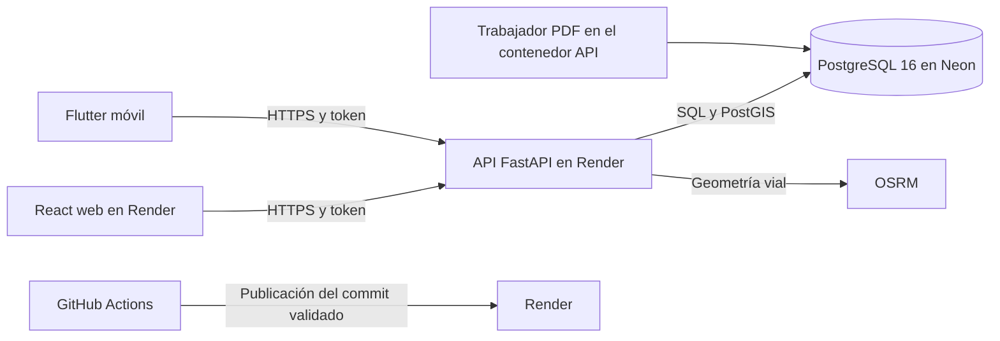

[← Volver al README Principal](../../README.md)

# Documento 12. Arquitectura de Software - Modelo C4

## 1. Información del documento

Proyecto: EcoLogística Lima (PFA-ECOLIMA-2026). Versión 1.1.0, 20/11/2026.
Esta versión describe la implementación verificada hasta Sprint 4. La versión 1.0.0 se conserva como diseño inicial; sus integraciones propuestas no acreditan servicios conectados.

## 2. Nivel 1: Contexto del sistema

Administración gestiona usuarios y parámetros. Oficina administra flota, conductores, pedidos y planificación según permisos. Repartidores consultan su itinerario, registran entregas y confirman regreso. Clientes consultan y editan pedidos propios. El servidor valida identidad, rol y permisos en cada operación protegida.

Las geometrías viales proceden de OSRM y los mapas se muestran con Leaflet/OpenStreetMap. Las incidencias son reportadas por oficina. No hay conexión de tráfico en vivo, compra de créditos ambientales, integración SERPAR ni correo SMTP desplegados. La compensación genera propuestas estimadas configurables, no certificados de compensación efectuada.

## 3. Nivel 2: Contenedores

La web es estática. La API y el trabajador PDF comparten contenedor gratuito, pero son procesos separados. Los reportes se persisten en PostgreSQL, no dependen del disco efímero del contenedor. Flutter mantiene operaciones pendientes localmente hasta que el servidor confirma su aceptación.

## 4. Nivel 3: Componentes

| Componente | Responsabilidad |
|---|---|
| `core/auth.py` | Contraseñas PBKDF2, tokens y permisos |
| `core/operational_time.py` | Fecha de operación en Lima; auditoría sigue en UTC |
| `planning_service.py` y `road_service.py` | Capacidad, jornada, ventanas, incidencias y trazado vial |
| `delivery_service.py` | Transiciones, validación del día, instantánea y cola de actualizaciones |
| `analytics_service.py` | Resumen por periodo y parámetros históricos |
| `report_service.py` y `report_worker.py` | Trabajos PDF persistidos, bloqueo de fila y recuperación |
| `sustainability.py` | Autorización de analítica y descarga privada |

## 5. Despliegue y límites

Web: https://ecologistica-web.onrender.com. API: https://ecologistica-api.onrender.com.
Credenciales únicamente en variables privadas del proveedor y GitHub Secrets. El esquema se aplica con `init.sql`, 006 y 007. Las publicaciones exigen CI y Tests del mismo commit. El servicio gratuito puede suspenderse por inactividad: no se afirma alta disponibilidad continua ni latencia garantizada inferior a 500 ms.

## 6. Historial de cambios

| Versión | Cambio |
|---|---|
| 1.0.0 | Diseño inicial conservado en su archivo original |
| 1.1.0 | Arquitectura implementada: Render/Neon, cola PostgreSQL, PDF, RBAC y fecha Lima; diferencia explícita entre integraciones propuestas y operativas |
