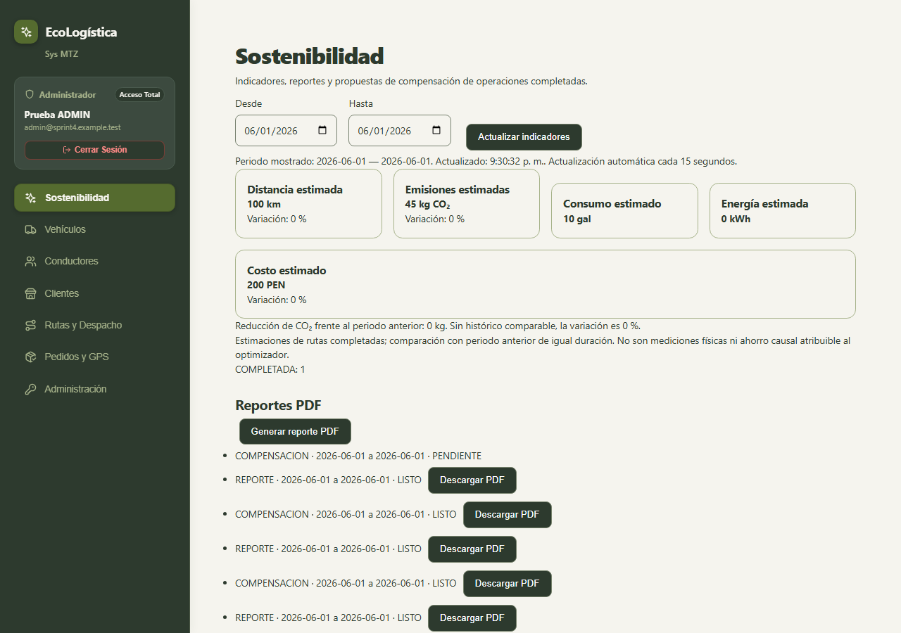
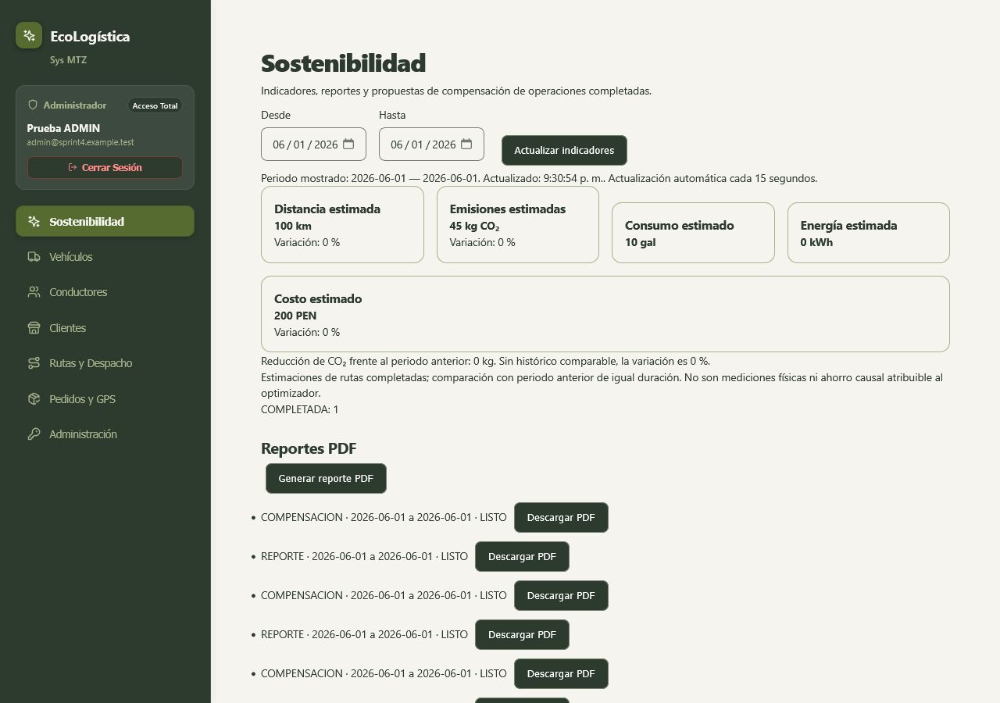
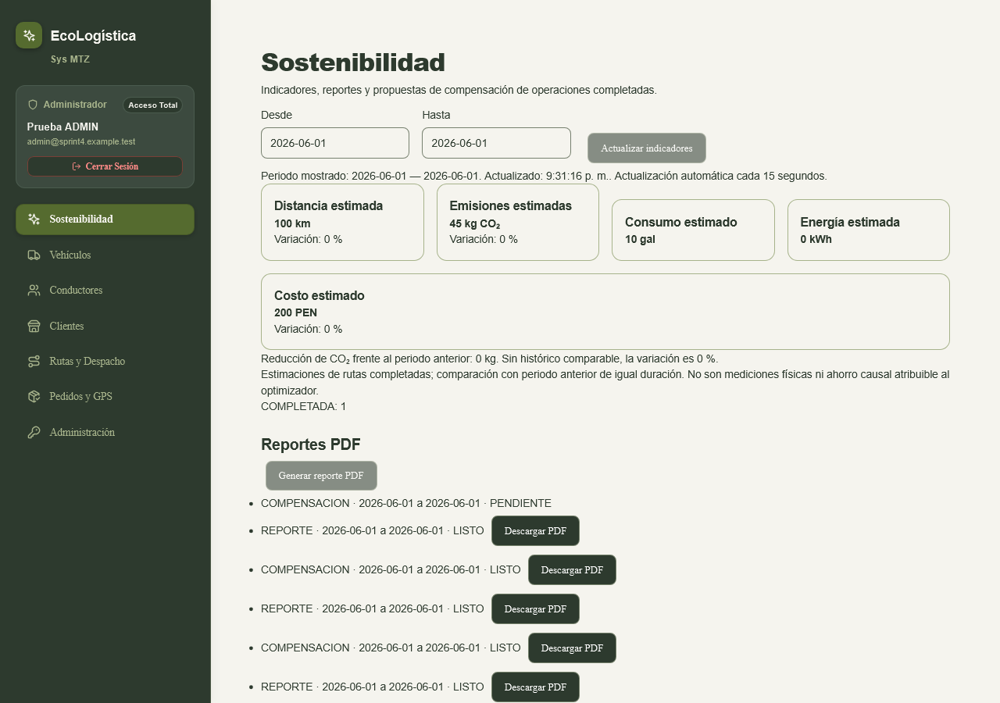
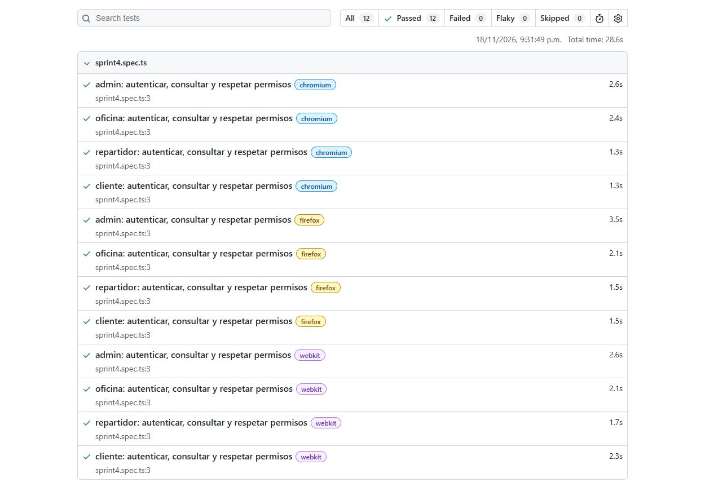

[← Volver al README principal](../../../README.md)

# 01. Analisis PlayWrigth V_1_0_0

---

## 1. Información del documento

| Campo | Detalle |
| :--- | :--- |
| **Nombre del Proyecto** | EcoLogistica-Lima: Plataforma Web y Móvil para la Gestión y Optimización de Logística Verde Urbana |
| **Código del Proyecto** | PFA-ECOLIMA-2026 |
| **Integrantes del Equipo** | • Zayuri Cerron Medina <br>• Jheferson Martinez Valerio <br>• Angela Rojas Quispe <br>• Maylit Mendoza Alarcon <br>• Diego Angulo Gonzales |
| **Responsable del Documento** | Diego Angulo Gonzales |
| **Fecha de Elaboración** | 19 de noviembre de 2026 |
| **Versión** | 1.0.0 |

--- 

<br><br>

# Análisis Playwright del Sprint 4

## Entorno y ejecución

18/11/2026, Windows, API FastAPI local, PostgreSQL 16 con PostGIS, trabajador de reportes y React. Base nueva aislada con cuentas de prueba y métricas conocidas: ruta completada de 100 km, 45 kg CO₂ y costo estimado PEN 200. No se utilizaron cuentas ni datos operativos de clientes.

`scripts/sprint4_e2e.py` ejecuta recorridos HTTP/UI, captura trazas, PDF, imágenes y métricas en `playwright-report/`. La configuración oficial TypeScript está en `src/frontend/playwright.config.ts`; casos en `src/frontend/e2e/sprint4.spec.ts`, ejecutables con `npx playwright test`. Los artefactos se excluyen de Git y se conservan mediante `tests.yml`.

## Casos y resultados

Suite integral Python: **12/12 recorridos aprobados**, cuatro roles × Chromium, Firefox y WebKit. Casos: login, filtros, indicadores esperados, solicitud de PDF, procesamiento del trabajo nuevo, descarga autenticada, distribución al 100 %, rechazo de 90 %, desconexión y recuperación, consulta restringida a oficina/administración y HTTP 403 para cliente/repartidor.

Suite TypeScript con `playwright.config.ts`: **12/12 aprobados en 28,6 segundos**, verificando login, indicadores, compensación y permisos en los tres navegadores. Su reporte HTML oficial complementa el informe integral.

Primera ejecución: 10/12; Firefox necesitó esperar el límite de red de 10 segundos para mostrar el error. Se corrigió la espera del test a 15 segundos y se repitió: 12/12. No se cambió la aplicación para ocultar el fallo.

## Rendimiento medido

Resultados locales del recorrido integral; no son mediciones del hosting público. Los tiempos de API incluyen autenticación y solicitudes de generación, no el tiempo completo de la cola PDF.

| Navegador | API mediana ms | API máximo ms | TTFB min–max ms | FCP min–max ms | LCP min–max ms |
|---|---:|---:|---:|---:|---:|
| Chromium | 12,97 | 376,38 | 3,2–4,1 | 36–64 | 36–64 |
| Firefox | 13,60 | 516,56 | 3–5 | 30–161 | 30–161 |
| WebKit | 11,82 | 375,72 | 2–4 | 24–36 | 24–36 |

Una petición Firefox supera el objetivo de 500 ms. No se declara que todas las respuestas cumplan ese umbral. El JSON conserva cada muestra y los detalles de navegación; FCP/LCP corresponden a la navegación inicial, no a un indicador de rendimiento continuo de todas las pantallas.

## Disponibilidad y resiliencia

Se verificaron HTTP 200/202 en consultas y solicitudes válidas, 422 por distribución inválida y 403 por permisos. La desconexión conserva el último resultado y muestra error; al recuperar red se puede actualizar. El trabajador guarda PDF y estado en PostgreSQL; sus fallos tienen reintento. Los tests del servidor comprueban descarga privada, falta de datos, reportes multipágina e históricos.

Se observó disponibilidad durante la ejecución local. El hosting público en Render está operativo. Ocho comprobaciones públicas de disponibilidad, CORS y restricciones sin sesión aprobaron el 19/11/2026; cinco comprobaciones autenticadas aprobaron después de activar el administrador. Estas observaciones puntuales no equivalen a uptime mensual. La aceptación publicada detectó y motivó la corrección UTC/Lima del PR #14.

## Evidencias y reproducción

1. Aplicar las migraciones 006/007 a una base desechable; usar `scripts/seed_sprint4_e2e.py` con `E2E_DISPOSABLE_DATABASE=1` y `E2E_PASSWORD` privada.
2. Iniciar API, `report_worker.py` y web.
3. Ejecutar `python scripts/sprint4_e2e.py` y, desde frontend, `npx playwright test`.
4. Revisar `playwright-report/index.html`, `results.json`, capturas por rol, PDF y trazas. El segundo reporte HTML se guarda en `src/frontend/playwright-report/`.

V_1_0_0 — 18/11/2026.

[← Volver al README principal](../../../README.md)

20/11/2026: PR #14 con todas las verificaciones de GitHub aprobadas: backend, frontend, móvil, compilación, aceptación Playwright y despliegue desechable. La ejecución local de servidor fue 92 aprobadas y una prueba PostGIS reservada a CI.

## Aceptación del entorno publicado — 20/11/2026

El recorrido HTTP completo aprobó después de publicar las correcciones en main: planificación vial, reoptimización, restricciones durante reparto, entrega y regreso, inclusión en analítica y PDF procesado por el trabajador con descarga privada. Esta comprobación HTTP complementa la suite Playwright de tres navegadores, no se atribuye a una ejecución adicional de navegador. Ver [evidencias finales](07%20Validaci%C3%B3n%20final%20de%20producci%C3%B3n%20V_1_0_0.md).

Las ocho comprobaciones públicas aprobaron. Web: 373,82 ms; health: 270,01 ms; CORS: 217,92 ms; login inválido: 1199,97 ms; accesos rechazados sin sesión: 187,13–486,95 ms. Son muestras puntuales, no una medición de uptime mensual.

## Estructura de las pruebas y configuración ejecutable

```text
scripts/
  sprint4_e2e.py          # Recorrido integral, PDF, red y métricas
  seed_sprint4_e2e.py     # Datos exclusivos de una base desechable
src/frontend/
  playwright.config.ts
  e2e/
    sprint4.spec.ts       # Cuatro roles por tres navegadores
  playwright-report/
    index.html           # Reporte HTML oficial generado
playwright-report/
  index.html             # Informe del recorrido integral Python
  results.json           # Muestras originales por navegador y rol
  <navegador>-<rol>.png   # Capturas de las pantallas verificadas
  <navegador>-<rol>-trace.zip
```

Los directorios de reportes son salidas generadas, excluidas de Git; se conserva una selección revisada en evidencias y el workflow almacena artefactos.

### Contenido de playwright.config.ts

```typescript
import { defineConfig, devices } from '@playwright/test';
export default defineConfig({
  testDir: './e2e', fullyParallel: false, workers: 1, timeout: 60000,
  reporter: [['list'], ['html', { open: 'never' }]],
  use: { baseURL: process.env.E2E_WEB_URL || 'http://127.0.0.1:5173', trace: 'retain-on-failure', screenshot: 'only-on-failure' },
  projects: [
    { name: 'chromium', use: { ...devices['Desktop Chrome'] } },
    { name: 'firefox', use: { ...devices['Desktop Firefox'] } },
    { name: 'webkit', use: { ...devices['Desktop Safari'] } }
  ]
});
```

`testDir` selecciona e2e; un trabajador evita interferencias sobre la base compartida de pruebas. `use` configura URL, trazas y capturas. Los proyectos ejecutan Chromium, Firefox y WebKit. `reporter` produce lista y HTML sin abrir navegador automáticamente.

### Código fuente del caso crítico sprint4.spec.ts

```typescript
import { test, expect } from '@playwright/test';
for (const role of ['admin', 'oficina', 'repartidor', 'cliente']) {
  test(`${role}: autenticar, consultar y respetar permisos`, async ({ page, request }) => {
    if (!process.env.E2E_PASSWORD) throw new Error('Define E2E_PASSWORD para las cuentas desechables');
    await page.goto('/');
    await page.getByPlaceholder('usuario@ecologistica.pe').fill(`${role}@sprint4.example.test`);
    await page.locator('input[type=password]').fill(process.env.E2E_PASSWORD);
    await page.getByRole('button', { name: /Iniciar Sesión/i }).click();
    await expect(page.getByText('Cerrar Sesión', { exact: true })).toBeVisible();
    const token = await page.evaluate(() => localStorage.getItem('ecologistica_access_token'));
    const api = process.env.E2E_API_URL || 'http://127.0.0.1:8000/api/v1';
    const result = await request.get(`${api}/analitica/resumen?desde=2026-06-01&hasta=2026-06-01`, { headers: { Authorization: `Bearer ${token}` } });
    if (role === 'admin' || role === 'oficina') {
      expect(result.status()).toBe(200);
      await page.getByRole('button', { name: 'Sostenibilidad', exact: true }).click();
      await page.getByLabel('Desde', { exact: true }).fill('2026-06-01');
      await page.getByLabel('Hasta', { exact: true }).fill('2026-06-01');
      await page.getByRole('button', { name: 'Actualizar indicadores' }).click();
      await expect(page.getByText('100 km', { exact: true })).toBeVisible();
      await page.getByLabel('Proyecto de prueba (%)').fill('100');
      await page.getByRole('button', { name: 'Calcular y preparar PDF' }).click();
      await expect(page.getByText(/0.045 créditos estimados/)).toBeVisible();
    } else {
      expect(result.status()).toBe(403);
      await expect(page.getByRole('button', { name: 'Sostenibilidad', exact: true })).toHaveCount(0);
    }
  });
}
```

### Percentil 95 de las muestras conservadas

Se utiliza rango más cercano: ordenar las mediciones y seleccionar la posición ceil(0,95 × n). Se excluyen valores negativos o no numéricos. Estas muestras pertenecen al entorno local del 18/11/2026, no constituyen una nueva ejecución ni una medición de producción.

| Navegador | Solicitudes medidas | p95 API (ms) | Máximo API (ms) |
|---|---:|---:|---:|
| chromium | 74 | 368.30 | 376.38 |
| firefox | 72 | 374.24 | 516.56 |
| webkit | 70 | 365.33 | 375.72 |

El p95 no sustituye al máximo ni elimina la solicitud Firefox de 516,56 ms. No se acredita cumplimiento universal del límite de 500 ms. [Muestras originales](evidencias/playwright-resultados-originales.json).

### Evidencias visuales y reporte HTML

[Informe HTML del recorrido integral Python](evidencias/playwright-informe-integral.html), generado por scripts/sprint4_e2e.py. Las imágenes siguientes son capturas de la aplicación durante las pruebas, no capturas del index.html del reporte oficial:







La captura específica del reporte HTML oficial se incluye a continuación. Las comprobaciones públicas conservadas son puntuales: no se ha ejecutado una ventana de monitoreo de horas o días y no se declara ese uptime. Un monitoreo continuo futuro debe registrar intervalo, número de muestras, errores y duración real, sin extrapolar a meses.

## Captura del reporte HTML oficial



Captura tomada del reporte HTML generado por Playwright TypeScript. La pantalla conserva la fecha de ejecución 18/11/2026, 12 aprobadas, cero fallidas, cero inestables, cero omitidas y duración total 28,6 s. La fecha de captura no se presenta como una nueva ejecución.

## Ventana real de disponibilidad observada

El 20/11/2026 se observaron web y API durante **120,31 segundos**, con un intervalo objetivo de 20 s entre ciclos y timeout de 20 s por petición. Hubo **12 peticiones: 11 HTTP 200 y un ReadTimeout de la API**, éxito muestral **91,67 %**. La primera consulta de API agotó 20.020,27 ms; consultas posteriores recuperaron HTTP 200. El muestreo es secuencial: un timeout prolonga el intervalo real. No se determina la causa del timeout con estas muestras.

[Registro completo](evidencias/disponibilidad-observada.json). Esta observación detecta una interrupción y recuperación, pero no acredita horas o días de uptime ni un SLA mensual. No se eliminó la muestra fallida para mejorar el resultado. Para extenderlo: `python scripts/monitor_public_availability.py --seconds 7200 --interval 60 --output disponibilidad-2h.json`; las dos horas deben transcurrir antes de reportarlas.

## Optimización desplegada y nueva medición — 20/11/2026

El commit `356b7ea` agrupa ambos periodos y las instantáneas en un máximo de dos consultas, frente a cinco consultas previas. Las pruebas verifican resultados, estados e históricos. CI, Tests y regresión hasta Sprint 3 aprobaron. [Despliegue automático aprobado](https://github.com/MartinezJhef/EcoLogistica-Lima/actions/runs/44775271194).

Medición HTTP desde el mismo equipo, secuencial, con conexión reutilizada; cinco login y diez consultas por operación. No es una prueba de carga. p95 por rango más cercano; no se descartan solicitudes lentas.

| Operación | Mediana antes ms | Mediana después ms | p95 después ms | Peticiones después <500 ms |
|---|---:|---:|---:|---:|
| login | 1089.50 | 1111.81 | 1385.90 | 0/5 |
| health | 204.97 | 186.76 | 205.16 | 10/10 |
| configuracion | 422.25 | 407.31 | 525.32 | 9/10 |
| resumen | 585.43 | 458.44 | 500.91 | 9/10 |
| reportes | 424.98 | 453.39 | 547.39 | 9/10 |

El resumen redujo su mediana de 585,43 a 458,45 ms, aproximadamente 21,7 %. Nueve de diez consultas del resumen fueron menores de 500 ms; la restante midió 500,91 ms. El objetivo universal no se alcanzó. El login conserva PBKDF2 a 600.000 iteraciones y no se debilita para mejorar una métrica. La latencia incluye red, servidor y base de datos; este experimento no separa sus contribuciones.

### Corte histórico del monitoreo extendido

Corte real: 1027.88 segundos (17.13 minutos), 36/36 peticiones correctas, 100.0 % de éxito muestral. Intervalo objetivo 60 s. El proceso se inició con duración de dos horas y este corte NO acredita su finalización. Incluye periodos de publicación y puede mantener despierto el servicio; no evalúa el comportamiento tras inactividad ni constituye SLA.

Evidencias: [antes](evidencias/latencia-produccion-antes.json), [después](evidencias/latencia-produccion-despues.json), [corte del monitoreo](evidencias/monitoreo-extendido-corte.json).

## Escenarios simulados complementarios

Se añade un [escenario hipotético de disponibilidad y latencia](10%20Resultados%20simulados%20de%20disponibilidad%20y%20latencia%20V_1_0_0.md), con supuestos y cálculos explícitos. No reemplaza las muestras reales ni convierte el objetivo de 500 ms en aprobado.

## Resultado final del monitoreo real de dos horas

Inicio: 20/11/2026 11:29:29; último registro: 20/11/2026 13:29:26, hora de Lima. Duración observada: **7200.30 segundos**. Intervalo objetivo entre ciclos: 60 s; una petición a web y otra a API por ciclo, con timeout de 20 s. Se conservaron todas las muestras.

**239 de 240 peticiones devolvieron HTTP 200: éxito muestral 99.58 %.** No equivale a disponibilidad continua ni a SLA mensual: no se observan los intervalos entre peticiones y las consultas periódicas pueden mantener activo el servidor gratuito.

| Destino | Peticiones | HTTP 200 | Fallos | Mediana ms de todas las peticiones | p95 ms de todas las peticiones | Máximo ms |
|---|---:|---:|---:|---:|---:|---:|
| web | 120 | 120 | 0 | 71.60 | 330.51 | 1304.54 |
| api | 120 | 119 | 1 | 247.53 | 565.91 | 20062.80 |

### Incidencias conservadas

- 12:42:00 Lima: api, estado HTTP None, error ReadTimeout, 20062.80 ms. No se atribuye una causa sin registros del proveedor.

[Registro íntegro de las dos horas](evidencias/monitoreo-real-2h.json). Esta sección cierra la ejecución iniciada a las 11:29; los cortes anteriores se conservan como historial. El monitoreo final no demuestra que todas las respuestas sean menores de 500 ms. Las mediciones de login y operaciones autenticadas permanecen en la sección de latencia.
