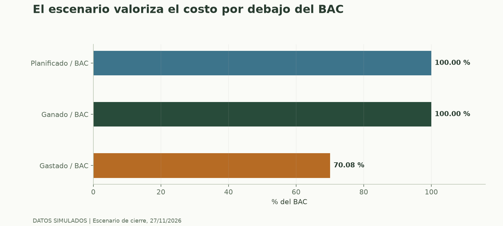
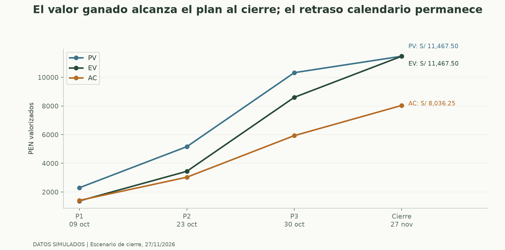

[← Volver al README principal](../../README.md)

# Reporte de Análisis de Valor Ganado - EVM

> **Modalidad de encuestas confirmada, 28/11/2026.** El usuario informa que el ingeniero permite encuestas simuladas. Se entregan cinco casos SUS como **resultados simulados**, media 77,5; este apartado no queda pendiente por falta de participantes reales. No cambia la meta original SUS ≥85 ni acredita aceptación humana. La autorización se limita a encuestas.

**Proyecto:** EcoLogística Lima · **Código:** PFA-ECOLIMA-2026
**Fecha de corte:** 27/11/2026 · **Versión:** 1.0.0
**Periodo actual:** 31/10–27/11/2026 · **Corte anterior:** 30/10/2026

> **Naturaleza de los datos.** Pruebas, commits y despliegues: evidencia técnica real, actualizada al 27/11/2026. Horas, costos incurridos del escenario, EVM, curvas complementarias y ánimo: **datos simulados**, autorizados para este cierre. No acreditan pagos, opiniones, reuniones ni aprobación de interesados.

**El EV de 100% corresponde solo al escenario financiero; el cierre de los sprints no acredita todos los requisitos no funcionales ni la aceptación humana.**

**BAC:** S/ 11467.50 · **Estado general:** cierre técnico modelado completo; retraso calendario real y aceptación humana pendiente.

> **Actualización de cierre, 28/11/2026.** Sprints 1–4 cerrados: diez historias, 67 SP y 99 subtareas terminadas. Jira conserva 122/123 actividades Listo y ANA-26 En curso: la revisión integral WCAG no está acreditada. Se verificaron 236 pruebas unitarias web, 54 casos de accesibilidad/sesión en tres navegadores, 16 árboles nativos de accesibilidad y tres comprobaciones del diálogo móvil con texto ampliado. CI y despliegue aprobados para `e31c545`. Disponibilidad mensual y respuestas siempre menores de 500 ms no acreditadas. Horas, costos, EVM, mood y SUS mantienen su identificación simulada; n humano SUS = 0. [Evidencia actual y límites](anexos/Cierre%20de%20validaciones%2028nov.md). El video queda fuera de este encargo.

## 1. Métricas de Desempeño EVM

Todos los importes de esta sección son **PEN simulados**. AC significa costo incurrido **del escenario**, no registro contable real.

| Métrica | Periodo actual | Acumulado actual | Acumulado anterior |
|---|---|---|---|
| PV | 1146.75 | 11467.50 | 10320.75 |
| EV | 2866.87 | 11467.50 | 8600.63 |
| AC | 2108.44 | 8036.25 | 5927.81 |
| SV | 1720.12 | 0.00 | -1720.12 |
| CV | 758.43 | 3431.25 | 2672.82 |
| SPI | 2.5000 | 1.0000 | 0.8333 |
| CPI | 1.3597 | 1.4270 | 1.4509 |

Periodo actual = acumulado 27/11 − acumulado 30/10 para PV, EV y AC. Los índices se calculan desde los importes de cada columna; **no se restan índices**. SV y CV se expresan en PEN, no en días.

### Base reproducible y criterio de reconocimiento

BAC se toma del presupuesto académico de USD 3058.00 × cambio interno 3.75 = S/ 11467.50, incluida contingencia. El tope S/ 12850.00 del acta no se usa como BAC: diferencia S/ 1382.50, sin autorización nueva para gastar.

PV acumulado modelado: 20%, 45%, 90%, 100%. EV acumulado modelado: 12%, 30%, 75%, 100%. Los cortes P1/P2/P3/P4 son un **escenario retrospectivo de gestión**, no exportaciones del historial Jira. EV reconoce paquetes presupuestados según aceptación técnica simulada; no convierte SP en dinero ni prueba aceptación humana total.

| Integrante / rol de referencia | P1 h | P2 h | P3 h | P4 h | Total h | PEN/h | Costo simulado |
|---|---|---|---|---|---|---|---|
| Zayuri / Dirección del proyecto | 45 | 45 | 75 | 55 | 220 | 6.5625 | 1443.75 |
| Jheferson / Liderazgo técnico | 45 | 55 | 100 | 70 | 270 | 7.50 | 2025.00 |
| Angela / Producto e interfaces | 50 | 55 | 80 | 55 | 240 | 6.375 | 1530.00 |
| Maylit / Calidad y riesgos | 30 | 45 | 100 | 85 | 260 | 6.375 | 1657.50 |
| Diego / Comunicaciones y soporte | 45 | 45 | 85 | 55 | 230 | 6.00 | 1380.00 |

Horas planificadas: 240 por integrante, 1200 total. Horas del escenario: 1220. Tarifas académicas originales: USD 1.75/2.00/1.70/1.70/1.60 por hora, multiplicadas por el cambio interno 3.75. AC = Σ(horas × tarifa); gastos externos y consumo de reserva del escenario = 0. La gratuidad autorizada de hosting no convierte el tiempo del equipo en costo real cero.

Regla de redondeo: cálculo Decimal y redondeo a céntimos por corte; el costo del periodo es la diferencia de acumulados. Así se evita una discrepancia de un céntimo por redondear periodos por separado. [Horas fuente](evidencias/horas-simuladas.csv), [modelo JSON](evidencias/escenario-cierre-simulado.json) y [tabla CSV](evidencias/evm-simulado.csv).

## 2. Porcentajes de Avance Acumulado (Respecto al BAC)

- Planificado: PV/BAC = 100.00%.
- Ganado: EV/BAC = 100.00%.
- Gastado: AC/BAC = 70.08%.

## 3. Análisis de Desviaciones

**Cronograma:** al corte anterior SPI = 0.8333 y SV = S/ -1720.12: se había ganado menos de lo planificado. Al cierre SPI = 1 por agotarse el trabajo presupuestado. El cierre técnico del 26/11 permanece 21 días después del objetivo 05/11; el cierre documental del 27/11 está 22 días después. No se altera la línea base para ocultarlo.

**Costo:** CPI final = 1.4270 y CV = S/ 3431.25. El escenario conserva herramientas/infraestructura gratuitas y usa más horas de integración/QA. La diferencia positiva es una comparación modelada contra un presupuesto que incluía recursos no contratados; no es ahorro real certificado. CPI queda fuera de la banda inicial 0.95–1.05 por debajo del costo previsto; se explica la composición en lugar de declarar cumplimiento artificial.

## 4. Estimaciones a la Conclusión (EAC)

| Fórmula | Acumulado anterior, 30/10 | Cierre, 27/11 |
|---|---|---|
| 1. BAC / CPI | S/ 7903.74 | S/ 8036.25 |
| 2. BAC / (CPI × SPI) | S/ 9484.48 | S/ 8036.25 |
| 3. AC + (BAC − EV) / (CPI × SPI) | S/ 8298.93 | S/ 8036.25 |

**Seleccionada: fórmula 3.** Al cierre EV = BAC y trabajo remanente = 0, por tanto ETC = 0 y EAC = AC = S/ 8036.25. Las tres fórmulas coinciden al cierre por SPI = 1 y EV = BAC. En el corte anterior no coinciden: la segunda penaliza el BAC entero por costo y cronograma, mientras la tercera aplica el rendimiento combinado solo al trabajo pendiente. Se usa precisión completa para índices y se redondea únicamente el resultado mostrado.

VAC = BAC − EAC = S/ 3431.25. TCPI sobre BAC no se utiliza al no existir trabajo pendiente del escenario. Aceptación humana, pilotos reales o nuevos servicios se estiman como trabajo futuro antes de comprometer fondos; no se ocultan dentro de ETC = 0.

## 5. Verificación

`python scripts/build_closure_figures.py` regenera datos y figuras; `python scripts/verify_closure.py` verifica fórmulas, sumas, enlaces y marcadores. El modelo financiero conserva explícitamente su condición simulada.

---

[← Volver al README principal](../../README.md)
