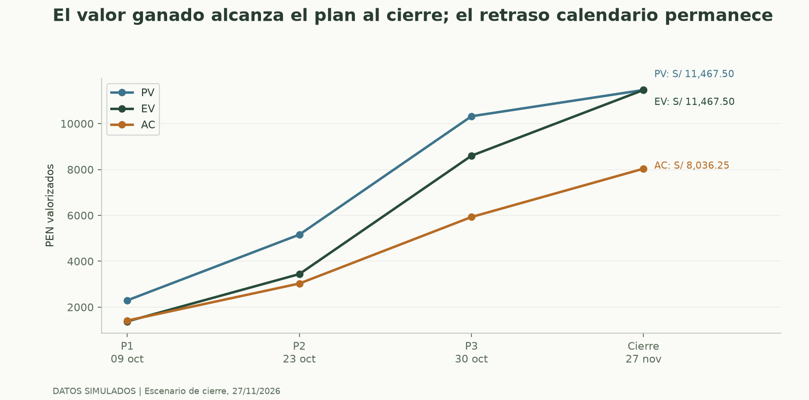
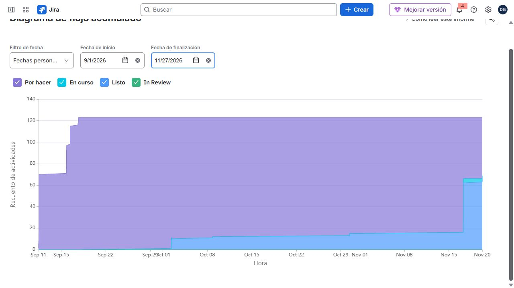
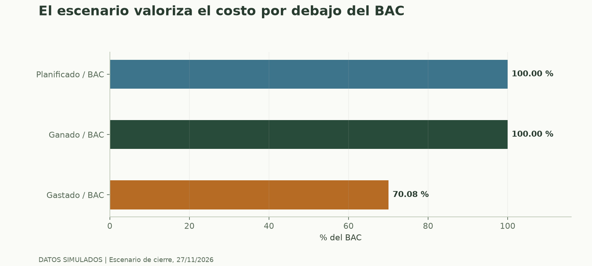

[← Volver al README principal](../../README.md)

# Tableros de Control Híbridos (Hybrid Dashboards)

**Proyecto:** EcoLogística Lima · **Código:** PFA-ECOLIMA-2026
**Fecha de corte:** 27/11/2026 · **Versión:** 1.0.0
**Periodo actual:** 31/10–27/11/2026 · **Corte anterior:** 30/10/2026

> **Naturaleza de los datos.** Pruebas, commits y despliegues: evidencia técnica real al 26/11/2026. Horas, costos incurridos del escenario, EVM, curvas complementarias y ánimo: **datos simulados**, autorizados para este cierre. No acreditan pagos, opiniones, reuniones ni aprobación de interesados.

**Frecuencia:** actualización técnica en cada integración/despliegue; revisión de gestión al cierre de cada sprint; corte consolidado 27/11/2026. No es un tablero en tiempo real.

> **Actualización con Jira real, 27/11/2026.** Las diez historias suman **67 SP**: siete en Listo (52 SP) y tres En curso (15 SP). Hay **40 subtareas abiertas**: 9 heredadas y 31 de Sprint 4. Los cuatro sprints siguen mostrando «Completar sprint». El escenario de 60 SP y el EVM del primer paquete continúan siendo **simulados**, no un reflejo del cierre formal de Jira. [Corte real y pendientes exactos](anexos/Conciliacion%20real%20de%20Jira%2027nov.md).

## 1. Justificación de Métricas (Principio Less is More)

PM y docente necesitan saber qué se entrega, cuánto se desvía y qué falta para aceptar. Desarrollo y QA necesitan defectos, flujo de revisión y resultados reproducibles. Se muestran cuatro familias: alcance/entrega, calendario/costo, calidad operativa y aceptación. No se incorporan métricas de vanidad ni se deduce productividad de commits.

Colores con redundancia textual: VERDE = evidencia técnica aprobada; ÁMBAR = condición/estimación; ROJO = evidencia real requerida ausente. Las tablas conservan valores, unidades y fuentes aunque la imagen se vea en escala de grises. Las figuras son PNG legibles y SVG vectoriales, sin depender de hover ni conexión.

## 2. Tabla Semáforo (RAG Chart) por Componente

| Componente / Entregable | Enfoque | Estado | Observación / Umbral |
|---|---|---|---|
| Requisitos, arquitectura y presupuesto | Predictivo | ÁMBAR | Versiones conciliadas; horas y ejecución financiera simuladas. |
| US-001–US-010 e integración | Adaptativo | VERDE técnico | Historias con implementación y recorridos automatizados; no equivale a aceptación de stakeholders. |
| Web, API, móvil y despliegue | Adaptativo | VERDE | 226 web + 103 backend/PostGIS, E2E multirrol y Android; workflows aprobados al 26/11. |
| Cronograma macro | Predictivo | ROJO | 21 días hasta estabilización técnica; 22 hasta corte documental frente al 05/11. |
| Costo / EVM | Predictivo | ÁMBAR | CPI 1.4270 del escenario; registro económico real no disponible. |
| SUS y aceptación humana | Híbrido | ROJO | n real = 0; cinco casos simulados, SUS 77.5. |
| Disponibilidad / latencia | Híbrido | ÁMBAR | 99.58% de 240 muestras en dos horas; máximo del resumen 500.91 ms; no SLA mensual. |
| Documentos y transición | Predictivo | ÁMBAR | Paquete y guía preparados; aceptación administrativa y capacitación por registrar. |

## 3. Gráficos de Desempeño Predictivo y Ágil

### 3.1 Tendencias de Variación y Valor Ganado (Líneas)

Interpretación: el EV simulado queda bajo PV hasta P3 y converge al cierre. La distancia EV–AC representa CV favorable del escenario; el retraso calendario se conserva aparte. Datos: [EVM CSV](evidencias/evm-simulado.csv).

### 3.2 Flujo Acumulado / Áreas Apiladas: evidencia real

Filtro visible: 01/09/2026–27/11/2026. La gráfica usa **recuento de actividades**, no Story Points, e incluye tipos distintos de historia. La banda de Por hacer domina y las resoluciones se concentran al final del historial visible. La vista de informes resume 123 actividades: 66 Listo, 54 Por hacer y 3 En curso; no se mezclan con las diez historias (67 SP). La reconstrucción simulada anterior se conserva como material de cálculo y no reemplaza esta evidencia real.

### 3.3 Relación Costo-Cronograma (SPI vs. CPI con tamaño CSI)

CSI se define aquí como **Cost-Schedule Index = CPI × SPI**, no índice de satisfacción. El área de cada burbuja es proporcional a CSI. El punto final (1.0000; 1.4270) conserva una advertencia: el SPI monetario no representa cumplimiento de la fecha original. Todos los puntos son simulados.

### 3.4 Medidores de Estado / Gráficos de Barras

Interpretación: 100% de PV/EV del escenario y 70.08% del BAC valorizado como AC. Se prefieren barras a medidores circulares porque permiten comparar directamente los tres valores. Un 100% modelado no convierte la evaluación humana en completada.

## 4. Acciones activadas por el tablero

PM registra aceptación y desviación de fecha; QA conserva pruebas; líder técnico observa hosting y latencia; producto coordina SUS real; comunicaciones consolida horas y datos faltantes. Responsabilidades propuestas según los roles documentados, sin atribuir asistencia o compromisos nuevos a una reunión no acreditada.

---

[← Volver al README principal](../../README.md)
