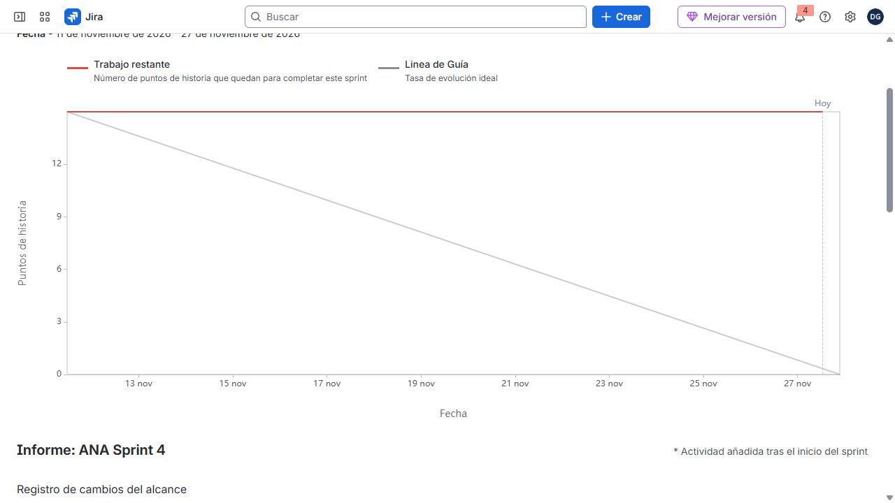
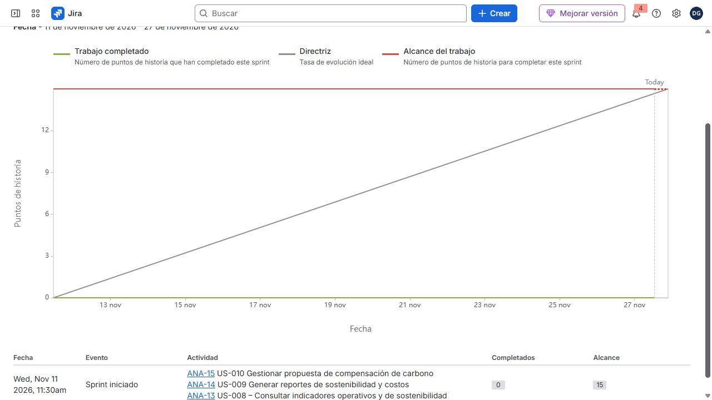
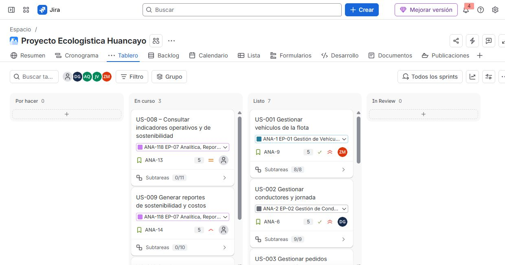
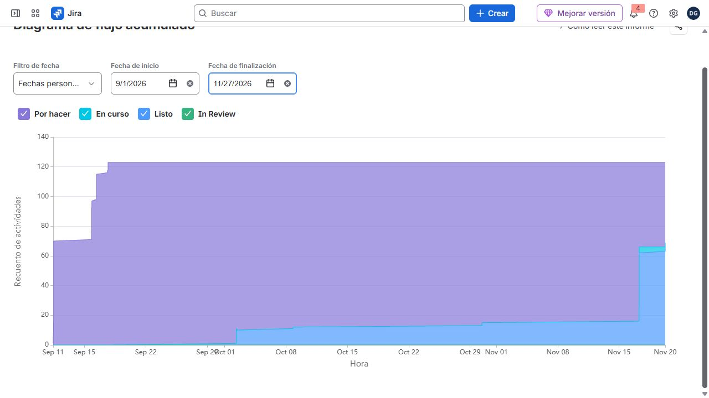
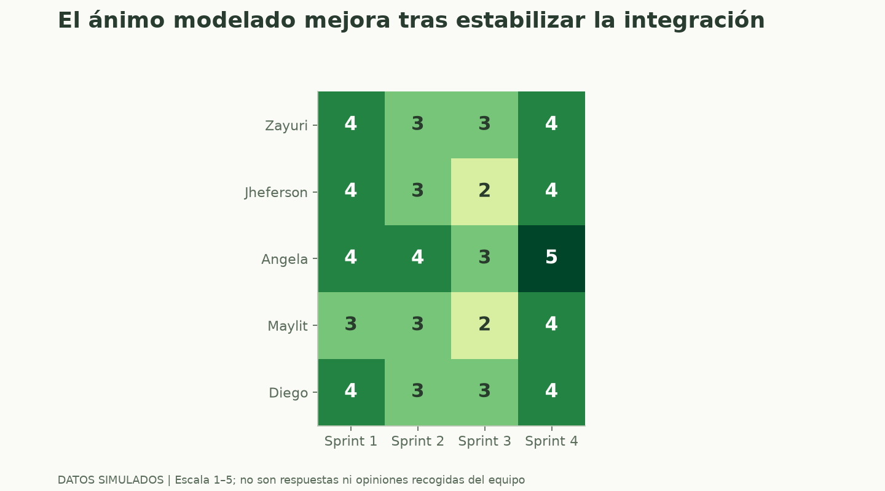

[← Volver al README principal](../../README.md)

# Radiadores de Información (Information Radiators)

**Proyecto:** EcoLogística Lima · **Corte:** 27/11/2026 · **Versión de entrega:** 1.0.0, revisión de evidencias 2. **Marco:** Scrum con gobierno predictivo.

## 1. Burndown Chart: captura real del Sprint 4

[Selector de Sprint 4 y fechas del informe](evidencias/jira-burndown-encabezado-sprint-4-27nov.jpg).

Informe oficial, Sprint ANA Sprint 4, 11–27 noviembre, unidad Puntos de historia. La línea de trabajo restante permanece en 15 frente a la guía descendente a cero. Jira no ha registrado puntos terminados del sprint, aunque haya implementación en GitHub. La velocidad de cierre registrada es cero, no la velocidad de desarrollo ni el resultado de las pruebas.

## 2. Burnup Chart: captura real del Sprint 4

[Selector de Sprint 4 y fechas del informe](evidencias/jira-burnup-encabezado-sprint-4-27nov.jpg).

Alcance de 15 SP; completados registrados 0. La tabla de eventos muestra el inicio del sprint el 11/11/2026 con ANA-13, ANA-14 y ANA-15, sin incremento posterior acreditado en ese informe. No se infiere que el código no exista: el gráfico refleja el registro de Jira. No se alteraron estados para producir una gráfica favorable.

## 3. Task Board / Kanban y flujo acumulado reales

Todos los sprints: 7 historias en Listo y 3 En curso; las tres del Sprint 4 no tienen responsable. Las columnas se conservaron sin cambios. El cuello de botella de gestión es la regularización de evidencias y subtareas antes del cierre: hay 40 subtareas abiertas, nueve heredadas. Una historia en Listo no elimina pendientes de sus hijos.

Filtro visible: 01/09–27/11/2026. Unidad: número de actividades de varios tipos; no SP ni solo historias. Predomina Por hacer y las resoluciones se concentran en el tramo final del historial visible. El panel global contiene 123 actividades, mientras la lista de historias tiene 10; no son denominadores intercambiables.

## 4. Mood Chart del equipo: resultados simulados autorizados

| Integrante / rol de referencia | Sprint 1 | Sprint 2 | Sprint 3 | Sprint 4 |
|---|---|---|---|---|
| Zayuri / dirección | 4 | 3 | 3 | 4 |
| Jheferson / técnico | 4 | 3 | 2 | 4 |
| Angela / producto e interfaz | 4 | 4 | 3 | 5 |
| Maylit / calidad | 3 | 3 | 2 | 4 |
| Diego / comunicaciones | 4 | 3 | 3 | 4 |

Escala 1–5. Media final simulada 4.2; media simulada de Sprint 3 2.6. No son respuestas recogidas de las personas nombradas. La simulación permite analizar presión de integración y recuperación al estabilizar pruebas; no acredita satisfacción real.

## 5. Retrospectiva: síntesis del expediente

La figura reconstruye la [retrospectiva versionada del Sprint 4](../03%20Implementaci%C3%B3n/Sprint%204/02%20Retrospectiva%20del%20Sprint%20V_1_0_0.md); no es fotografía de una reunión. Mantener: lógica compartida, permisos y pruebas en base real. Mejorar: coordinación de aceptación, carga y evidencia de gestión. Acciones técnicas ya verificadas: fecha Lima, CI/CD y regresiones. La discusión y aceptación por participantes debe registrarse cuando ocurra.

## 6. Trazabilidad y material complementario

[Corte real con pendientes exactos](anexos/Conciliacion%20real%20de%20Jira%2027nov.md) y [datos observados](evidencias/jira-corte-real-27nov.json). Las antiguas curvas de 60 SP se conservan como **escenario simulado** en [CSV](evidencias/radiadores-simulados.csv), no como exportación de Jira. El estado real consultado suma 67 SP.

Se completa así la evidencia gráfica real disponible. Mood, horas y costos mantienen su condición simulada autorizada; la simulación no convierte una reunión propuesta en reunión realizada ni cambia los criterios de evidencia real del docente.

[← Volver al README principal](../../README.md)
