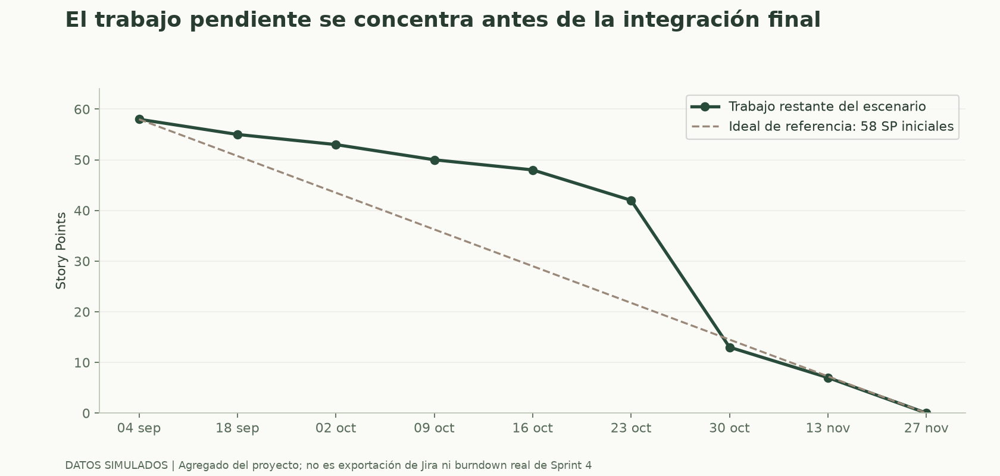
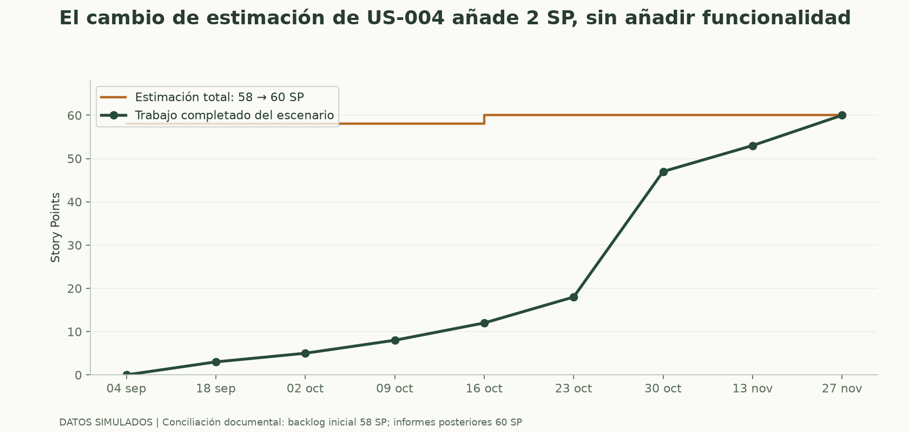

[← Volver al README principal](../../README.md)

# Radiadores de Información (Information Radiators)

**Proyecto:** EcoLogística Lima · **Código:** PFA-ECOLIMA-2026
**Fecha de corte:** 27/11/2026 · **Versión:** 1.0.0
**Periodo actual:** 31/10–27/11/2026 · **Corte anterior:** 30/10/2026

> **Naturaleza de los datos.** Pruebas, commits y despliegues: evidencia técnica real al 26/11/2026. Horas, costos incurridos del escenario, EVM, evolución de radiadores y ánimo: **datos simulados**, autorizados para este cierre. No acreditan pagos, opiniones, reuniones ni aprobación de interesados.

**Marco ágil:** Scrum con gobierno predictivo de presupuesto, riesgos e hitos. **Lectura:** evidencias reales históricas más reconstrucciones simuladas claramente rotuladas.

## 1. Burndown Chart (Trabajo Restante)

La serie corresponde al proyecto agregado, no al Sprint 4 de 13 SP. El ideal parte de 58 SP y desciende linealmente; el modelo pasa a 60 al revisar US-004. Trabajo restante final: 0 SP **del escenario**. El avance no es uniforme: la concentración de terminaciones al cierre de integración sugiere evitar lotes grandes. No se calcula una velocidad real diaria desde esta simulación.

## 2. Burnup Chart (Trabajo Completado y Cambios de Alcance)

La estimación total pasa de 58 a 60 SP por US-004 de 3 a 5 SP; se mantienen diez historias. No se confunde un aumento de estimación con una nueva funcionalidad. Distribución reconciliada por incremento: 8, 10, 29 y 13 SP. Promedio aritmético 15 SP/incremento; no se usa como pronóstico de velocidad porque los incrementos no acreditan igual duración/capacidad. [Datos simulados](evidencias/radiadores-simulados.csv).

## 3. Task Board / Tablero Kanban

**Captura real histórica ya incluida en el artefacto Jira**, sin fecha verificable en la imagen. Muestra Por hacer, En curso, Listo e In Review; las tres tarjetas visibles están en Por hacer y las demás columnas en cero. El encabezado dice «Proyecto Ecologistica Huancayo»: inconsistencia de denominación frente a EcoLogística Lima que debe conciliar el equipo. No prueba el estado final ni se editó para aparentar tareas terminadas.

Cuello de botella visible: trabajo concentrado en Por hacer y una columna In Review posterior a Listo en la captura. Se conserva la decisión del usuario de **no cambiar columnas**. Acción: revisar el mapeo de estados y obtener una exportación/captura actual antes de declarar sprints cerrados; no se realizaron modificaciones en Jira durante este cierre.

La captura usa otra agrupación/estimación de historias que el backlog textual. Por eso no se mezclan sus puntos ni sus fechas con las series simuladas. Las claves ANA visibles son evidencia histórica; no se inventan correspondencias para otras historias.

## 4. Mood Chart (Estado de Ánimo del Equipo)

| Integrante / rol de referencia | Sprint 1 | Sprint 2 | Sprint 3 | Sprint final |
|---|---|---|---|---|
| Zayuri / Dirección del proyecto | 4 | 3 | 3 | 4 |
| Jheferson / Liderazgo técnico | 4 | 3 | 2 | 4 |
| Angela / Producto e interfaces | 4 | 4 | 3 | 5 |
| Maylit / Calidad y riesgos | 3 | 3 | 2 | 4 |
| Diego / Comunicaciones y soporte | 4 | 3 | 3 | 4 |

Escala 1 muy bajo a 5 muy alto. **Todos los valores son simulados** y no representan opiniones de las personas nombradas. Media final 4.2/5; media de Sprint 3 2.6/5. Hipótesis del escenario: presión de integración y recuperación al estabilizar pruebas. Se recomienda medir voluntariamente y acordar mejoras de carga sin usar el ánimo como evaluación individual.

## 5. Tableros de Retrospectiva

Reconstrucción de la [retrospectiva versionada del Sprint 4](../03%20Implementaci%C3%B3n/Sprint%204/02%20Retrospectiva%20del%20Sprint%20V_1_0_0.md), no captura de una reunión. **Funcionó:** lógica compartida, permisos del servidor y pruebas reproducibles. **Mejorar:** validación con participantes, distribución de responsabilidades y calidad de evidencias. **Implementado técnicamente:** fecha Lima, regresiones, CI/CD y corrección de flujos. **Propuesto:** sesión real de aceptación y registro de sus acuerdos.

## 6. Límite de cumplimiento

La consigna solicita radiadores reales usados durante la ejecución. Se aporta el tablero real histórico existente; burndown, burnup, flujo y mood se entregan como simulados, y la retro como reconstrucción. Esto completa el material solicitado con la autorización recibida, pero **no acredita que esas gráficas fueran observadas en Jira ni sustituye las capturas reales exigidas por la rúbrica**.

---

[← Volver al README principal](../../README.md)
