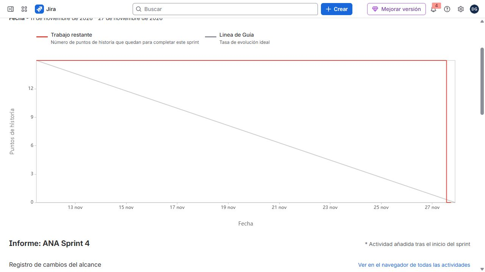
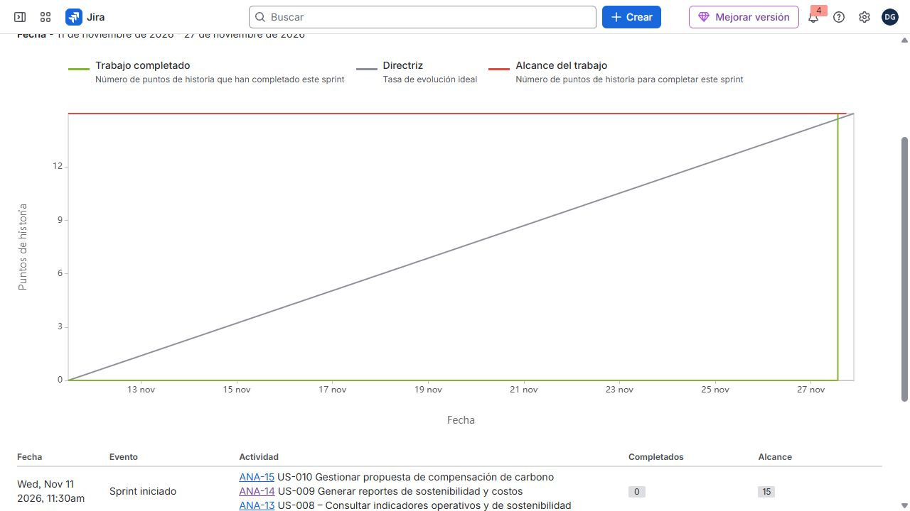
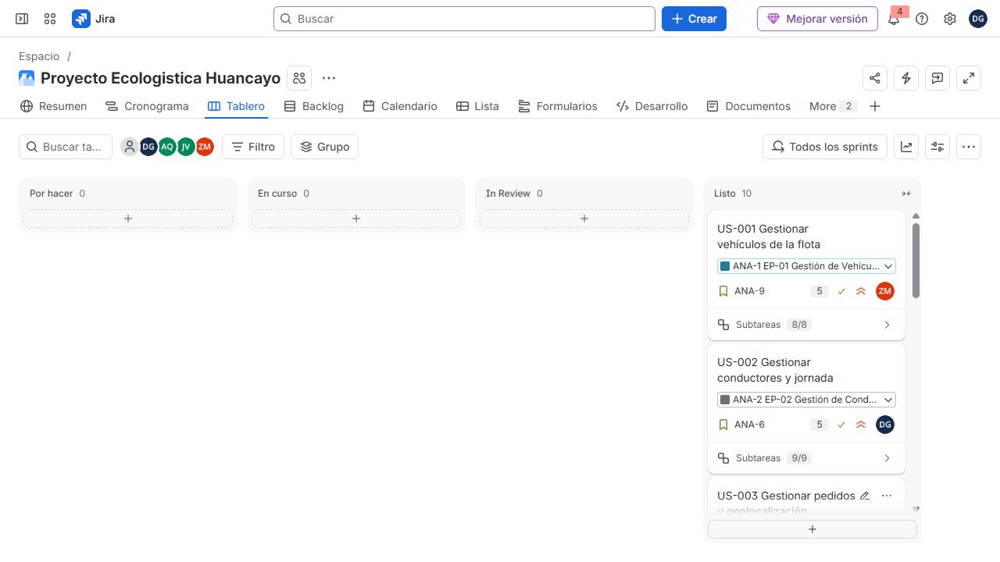
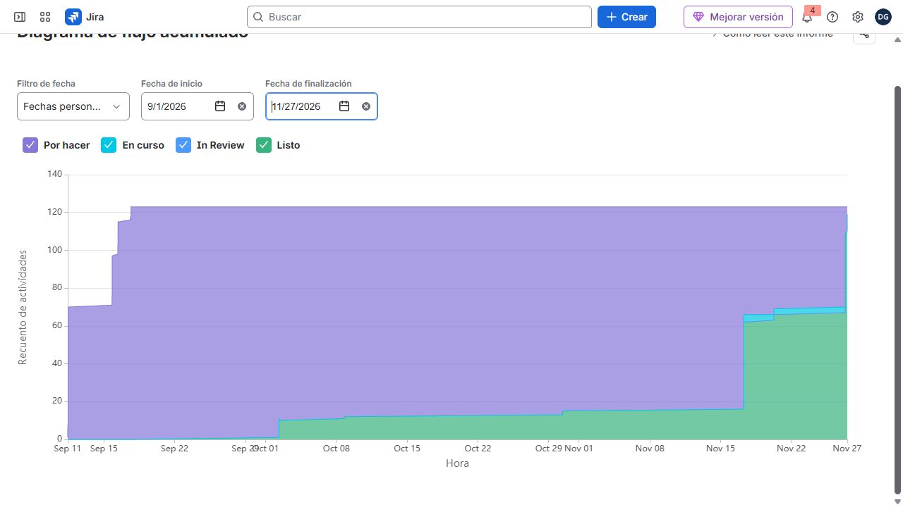
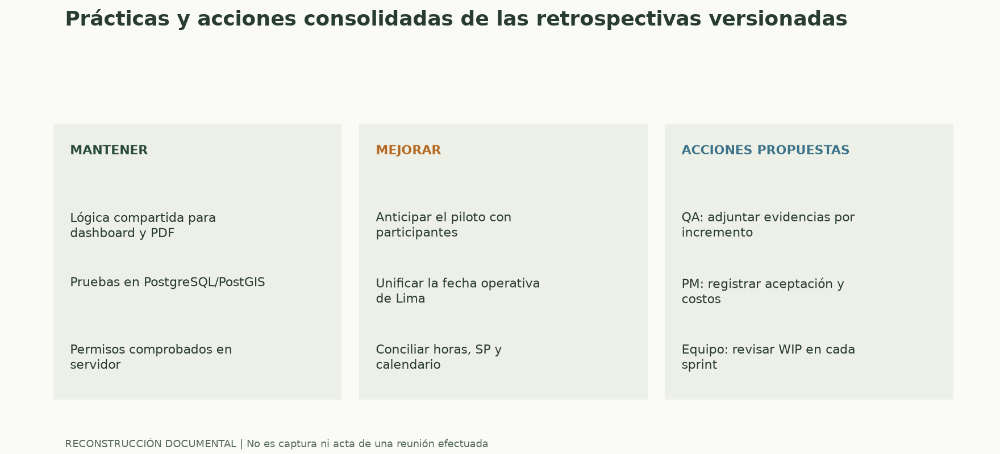

[← Volver al README principal](../../README.md)

# Radiadores de Información (Information Radiators)

**Proyecto:** EcoLogística Lima · **Corte:** 27/11/2026 · **Versión de entrega:** 1.0.0, revisión de evidencias 2. **Marco:** Scrum con gobierno predictivo.

> **Actualización de cierre, 28/11/2026.** Sprints 1–4 cerrados: diez historias, 67 SP y 99 subtareas terminadas. Jira conserva 122/123 actividades Listo y ANA-26 En curso: la revisión integral WCAG no está acreditada. Se verificaron 236 pruebas unitarias web, 54 casos de accesibilidad/sesión en tres navegadores, 16 árboles nativos de accesibilidad y tres comprobaciones del diálogo móvil con texto ampliado. CI y despliegue aprobados para `19478a4`. Disponibilidad mensual y respuestas siempre menores de 500 ms no acreditadas. Horas, costos, EVM, mood y SUS mantienen su identificación simulada; n humano SUS = 0. [Evidencia actual y límites](anexos/Cierre%20de%20validaciones%2028nov.md). El video queda fuera de este encargo.

## 1. Burndown Chart: Sprint 4 cerrado

Alcance 15 SP; trabajo restante **0** al cierre del 27/11. La caída final registra cuándo se actualizaron las historias en Jira; no demuestra que todo el desarrollo ocurriera ese día. Se conserva la captura inicial con 15 pendientes para trazabilidad.

## 2. Burnup Chart: Sprint 4 cerrado

Completados **15/15 SP**, sin aumento del alcance. Las tablas oficiales registran «Sprint completado» para los cuatro sprints: 10/10, 13/13, 29/29 y 15/15 SP. [Eventos originales transcritos de Jira](evidencias/jira-sprints-cerrados-27nov.json). Las fechas de cierre administrativo del 27/11 se conservan; no se retrocedieron a las fechas previstas.

## 3. Kanban y flujo acumulado reales

La captura muestra las diez historias en Listo antes de terminar los sprints. Orden publicado con autorización expresa: Por hacer → En curso → In Review → Listo. Al quedar Listo al final, Jira pudo cerrar los sprints sin trasladar historias al backlog. Después del cierre, el tablero de sprints activos puede aparecer vacío: los elementos permanecen en los informes y el historial.

Captura histórica de 123 actividades de distintos tipos: 119 Listo y cuatro Por hacer. El corte de calidad posterior tiene 122 Listo y ANA-26 En curso. No se presentan como 123 historias. Las 99 subtareas funcionales y siete épicas están terminadas.

## 4. Mood Chart del equipo: resultados simulados autorizados

| Integrante / rol de referencia | Sprint 1 | Sprint 2 | Sprint 3 | Sprint 4 |
|---|---|---|---|---|
| Zayuri / dirección | 4 | 3 | 3 | 4 |
| Jheferson / técnico | 4 | 3 | 2 | 4 |
| Angela / producto e interfaz | 4 | 4 | 3 | 5 |
| Maylit / calidad | 3 | 3 | 2 | 4 |
| Diego / comunicaciones | 4 | 3 | 3 | 4 |

Escala 1–5. Media final simulada 4.2; media simulada de Sprint 3 2.6. No son respuestas recogidas de las personas nombradas. La simulación permite analizar presión de integración y recuperación al estabilizar pruebas; no acredita satisfacción real.

## 5. Retrospectiva: síntesis del expediente

La figura reconstruye la [retrospectiva versionada del Sprint 4](../03%20Implementaci%C3%B3n/Sprint%204/02%20Retrospectiva%20del%20Sprint%20V_1_0_0.md); no es fotografía de una reunión. Mantener: lógica compartida, permisos y pruebas en base real. Mejorar: coordinación de aceptación, carga y evidencia de gestión. Acciones técnicas ya verificadas: fecha Lima, CI/CD y regresiones. La discusión y aceptación por participantes debe registrarse cuando ocurra.

## 6. Trazabilidad y material complementario

[Corte real con pendientes exactos](anexos/Conciliacion%20real%20de%20Jira%2027nov.md) y [datos observados](evidencias/jira-corte-real-27nov.json). Las antiguas curvas de 60 SP se conservan como **escenario simulado** en [CSV](evidencias/radiadores-simulados.csv), no como exportación de Jira. El corte inicial sumaba 67 SP; el corte final conserva esos puntos y cierra sus cuatro sprints.

Se completa así la evidencia gráfica real disponible. Mood, horas y costos mantienen su condición simulada autorizada; la simulación no convierte una reunión propuesta en reunión realizada ni cambia los criterios de evidencia real del docente.

[← Volver al README principal](../../README.md)
