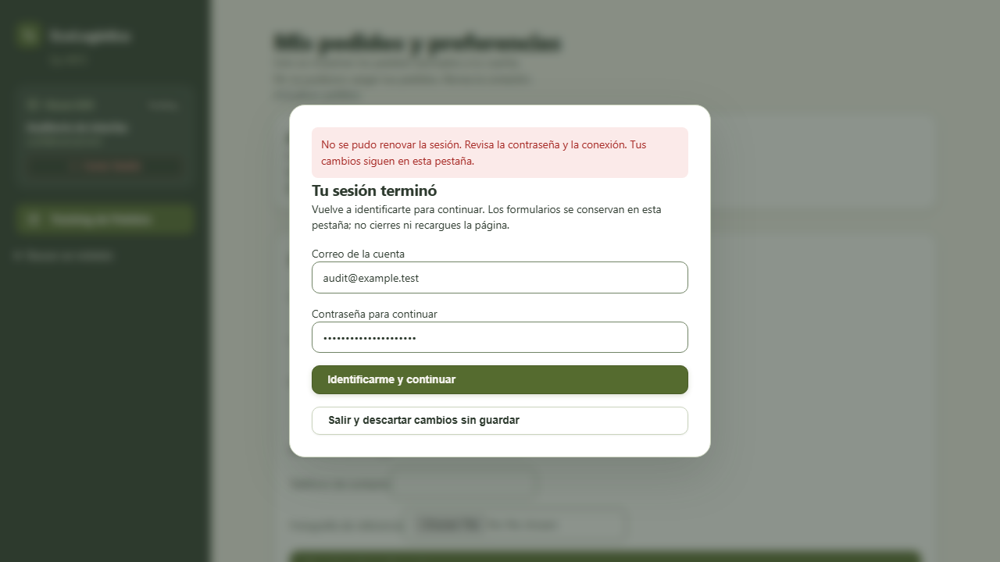
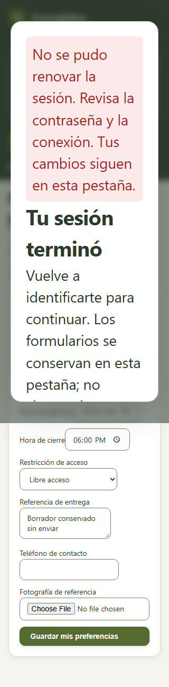

[← Volver al README principal](../../../README.md)

# Cierre de validaciones y recopilación de evidencia — 28/11/2026

## Accesibilidad, navegación y sesión

Se ejecutaron **236 pruebas unitarias web** y **54 pruebas de navegador** en Chromium, Firefox y WebKit. Las 54 comprenden los quince escenarios de interfaz anteriores y tres recorridos adicionales por navegador: sesión vencida con borrador, aviso anticipado de vencimiento y búsqueda de módulos según rol.

La publicación `e31c545` aprobó además **66/66 pruebas de navegador en CI**: esos 54 casos más doce comprobaciones de autenticación y permisos contra la API y PostGIS desechables, cuatro roles en cada navegador. El [registro de resultados y origen](../evidencias/playwright-ci-66-28nov.json) conserva la ejecución real y su alcance.

Se inspeccionó la interfaz **nativa de accesibilidad de Chromium** en los quince escenarios principales y en el diálogo de error de reidentificación: dieciséis árboles nativos. Los controles expuestos tienen nombre y rol; los encabezados están presentes. El diálogo y su alerta aparecen en el árbol nativo, mientras la navegación de fondo queda excluida. Solo se conservaron nombres y roles, sin valores de contraseñas. Es una comprobación de la interfaz que consumen las tecnologías de asistencia, no una grabación de voz ni una evaluación SUS humana.

La sesión avisa 90 segundos antes de expirar. Al expirar o recibir HTTP 401, se elimina el token, se bloquea la interacción con el fondo y se conserva el formulario únicamente en la memoria de la pestaña. Una contraseña rechazada no borra el borrador ni desbloquea el sistema. La misma cuenta y rol pueden volver a identificarse; una identidad o rol distintos descartan el contexto anterior. Salir explícitamente descarta lo no guardado. Cerrar o recargar la pestaña no conserva el borrador. No se alargó la vigencia del token de ocho horas ni se modificaron las autorizaciones del servidor.

Se añadió una segunda forma de localizar módulos: «Buscar un módulo», con resultados limitados a las opciones del rol. Escribir no cambia de página; la navegación ocurre al activar un enlace. Los campos de datos personales identifican su propósito de autocompletado cuando corresponde.

[Ejecuciones y árboles nativos](../evidencias/auditoria-accesibilidad-sesion-28nov.json) · [Pruebas de sesión y navegación](../../../src/frontend/e2e/session-accessibility.spec.ts) · [Recuperación de sesión](../../../src/frontend/src/components/SessionRecovery.tsx).

También pasaron **3/3 comprobaciones** del diálogo de recuperación a 320 CSS px con el texto duplicado, una por navegador, sin controles recortados: [ejecución](../evidencias/sesion-movil-texto-ampliado-28nov.json).

[CI, pruebas, integración, Green IT y despliegue de la versión publicada](../evidencias/validacion-cierre-28nov.json). La verificación se vincula a su commit exacto; los cambios posteriores se someten de nuevo a estos controles antes de publicar.

La [verificación pública posterior al despliegue](../evidencias/verificacion-publica-cierre-28nov.json) obtuvo HTTP 200 en web y salud de la API, y comprobó en los archivos servidos la recuperación de sesión, búsqueda de módulos, ajuste móvil, foco y alternativa por coordenadas. Fue una revisión de lectura, sin crear ni modificar registros de producción.

Estas verificaciones completan los recorridos de revisión técnica descritos en este expediente. No se presentan como certificación universal de todos los navegadores, lectores de pantalla y estados futuros. Se conservan las comprobaciones anteriores de contraste, etiquetas, teclado, seis diálogos, reflujo, texto ampliado y espaciado, con sus alcances y reglas incompletas identificadas.

## Disponibilidad y tiempos de respuesta: resumen de evidencia real

Se consolidaron cuatro archivos de muestras originales, sin eliminar fallos ni considerar las horas ausentes como disponibles. Para noviembre, entre 05:00 y 22:00 de Lima, hay 125 muestras de web y 125 de API: 125/125 y 123/125 correctas respectivamente. El p95 de todos los intentos es 330,51 ms para web y 590,61 ms para API. El máximo de API conserva el timeout de 20.063,41 ms. Son peticiones a la página pública y al endpoint de salud, no a todas las funcionalidades.

Solo diez de los 1.020 espacios horarios por destino del mes tienen alguna observación: **0,98 % de cobertura horaria de muestreo**. El denominador incluye todo noviembre, también sus horas futuras al momento del corte. Un espacio con una muestra no representa una hora entera de servicio; los huecos no se contabilizan como éxitos ni como caídas acreditadas. **No está acreditado el SLA mensual ni un tiempo universal inferior a 500 ms.** Las mediciones de ventanas breves favorables no reemplazan este resumen.

[Resumen reproducible con fuentes](../evidencias/resumen-disponibilidad-real-28nov.json) · [Analizador](../../../scripts/summarize_availability.py) · [Pruebas de contabilidad de fallos y huecos](../../../scripts/tests/test_availability_summary.py).

El workflow conserva muestras y ahora genera también un resumen que identifica cobertura y fallos. Se programa al minuto 17 entre 05:17 y 21:17 de Lima para evitar el pico de inicio de hora; [GitHub documenta que ese pico puede retrasar o descartar ejecuciones](https://docs.github.com/en/actions/reference/workflows-and-actions/events-that-trigger-workflows#schedule). Esto reduce una causa posible de retraso, sin garantizar la ejecución. No se declara que ya haya ocurrido una ejecución del cron sin observar su evento.

La [ejecución manual del workflow actualizado](https://github.com/MartinezJhef/EcoLogistica-Lima/actions/runs/46112370394) terminó correctamente: se descargaron y comprobaron sus dos artefactos, `sample.json` y `summary.json`, con web/API HTTP 200. La [evidencia original y el resumen generado](../evidencias/ejecucion-monitor-resumen-28nov.json) se conservan. Ocurrió a las 00:30 de Lima, fuera de la ventana 05:00–22:00; por eso no incrementa los conteos del resumen mensual anterior. Es una prueba real del workflow, no una observación de un evento del cron.

## Para sustituir las encuestas simuladas por respuestas reales

El instrumento y las tareas ya están en el [protocolo de despliegue y evaluación](../../03%20Implementaci%C3%B3n/Sprint%204/06%20Despliegue%20y%20evaluaci%C3%B3n%20V_1_0_0.md). Se añadió una [plantilla de captura sin respuestas](respuestas-sus-por-completar.json): P01–P05 son identificadores reservados, no participantes ya evaluados.

1. Cada participante usa el sistema con una cuenta y rol habilitados por administración, realiza las tareas del protocolo y responde los diez ítems, de 1 a 5, con su propia opinión.
2. En una copia de la plantilla, se escribe cada lista de diez respuestas y se conserva por separado fecha, rol, tareas realizadas y observaciones. No hacen falta contraseñas ni nombres completos en el repositorio.
3. Se calcula con `python scripts/sus_score.py ruta-de-las-respuestas.json`. El calculador rechaza respuestas incompletas, fuera de rango o identificadores repetidos; no genera respuestas de personas.
4. Se incorpora el resultado como una nueva evidencia, conservando el anexo simulado previo y sin mezclarlo con la muestra real.

La plantilla vacía no acredita cinco participantes. Mientras no se reciban respuestas humanas, el expediente mantiene **n real = 0** y cinco casos simulados, media simulada 77,5. Horas, costos, EVM y mood simulados conservan también su identificación. La preparación documental no acredita que se haya realizado una sustentación o una reunión de aceptación.

## Video

Permanece fuera de este encargo por instrucción del usuario. Este registro no lo produce, modifica ni declara entregado.

[← Volver al README principal](../../../README.md)
