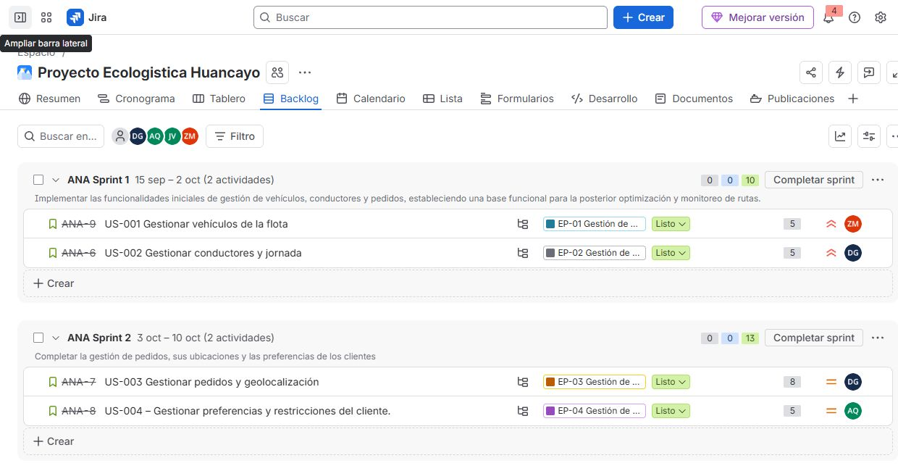
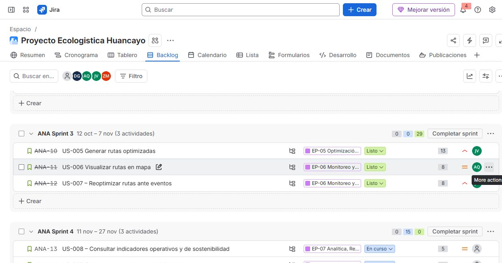
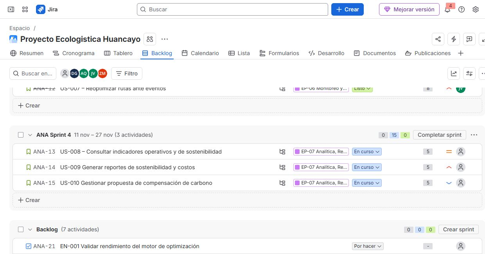
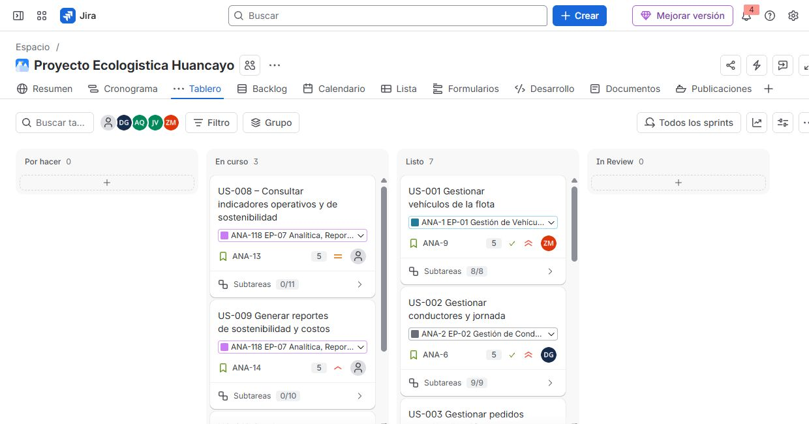

[← Volver al README principal](../../../README.md)

# Conciliación real de Jira y GitHub

**Consulta:** 27/11/2026. **Proyecto Jira:** ANA, nombre visible «Proyecto Ecologistica Huancayo»; repositorio/aplicación: EcoLogística Lima. No se cambió el nombre ni las columnas. Se añadió únicamente la pestaña Informes con autorización expresa del usuario.

> **Corte inicial histórico.** Las 40 subtareas y los cuatro sprints abiertos de este documento fueron regularizados posteriormente el mismo 27/11. Se conserva este hallazgo y sus capturas como antecedente. Consulte el [estado final del cierre](Estado%20final%20del%20cierre%20Jira.md).

## 1. Estado real de las diez historias

| Historia Jira | US | Sprint | SP | Estado | Subtareas Listo / total |
|---|---|---|---|---|---|
| [ANA-9](https://continental-team-yg5bc6tv.atlassian.net/browse/ANA-9) | US-001 | 1 | 5 | Listo | 8/8 |
| [ANA-6](https://continental-team-yg5bc6tv.atlassian.net/browse/ANA-6) | US-002 | 1 | 5 | Listo | 9/9 |
| [ANA-7](https://continental-team-yg5bc6tv.atlassian.net/browse/ANA-7) | US-003 | 2 | 8 | Listo | 9/9 |
| [ANA-8](https://continental-team-yg5bc6tv.atlassian.net/browse/ANA-8) | US-004 | 2 | 5 | Listo | 8/9 |
| [ANA-10](https://continental-team-yg5bc6tv.atlassian.net/browse/ANA-10) | US-005 | 3 | 13 | Listo | 10/12 |
| [ANA-11](https://continental-team-yg5bc6tv.atlassian.net/browse/ANA-11) | US-006 | 3 | 8 | Listo | 9/10 |
| [ANA-12](https://continental-team-yg5bc6tv.atlassian.net/browse/ANA-12) | US-007 | 3 | 8 | Listo | 6/11 |
| [ANA-13](https://continental-team-yg5bc6tv.atlassian.net/browse/ANA-13) | US-008 | 4 | 5 | En curso | 0/11 |
| [ANA-14](https://continental-team-yg5bc6tv.atlassian.net/browse/ANA-14) | US-009 | 4 | 5 | En curso | 0/10 |
| [ANA-15](https://continental-team-yg5bc6tv.atlassian.net/browse/ANA-15) | US-010 | 4 | 5 | En curso | 0/10 |

Total **67 SP**: 52 en historias con estado Listo y 15 En curso. Subtareas: **59 Listo / 99 totales**; pendientes 40. Este recuento no incluye como subtareas las siete épicas ni los siete enablers del backlog.

Los cuatro sprints muestran el botón «Completar sprint», por lo que no se declaran cerrados formalmente. Sprint 1: 15 sep–2 oct; Sprint 2: 3–10 oct; Sprint 3: 12 oct–7 nov; Sprint 4: 11–27 nov. Se transcriben los periodos visibles, sin inventar fechas de cierre administrativo.

## 2. Diferencia de puntos frente a documentos previos

Backlog original: 58 SP; escenario documental conciliado: 60 SP; **Jira consultado: 67 SP**. Las diferencias entre 60 y 67 son US-002 (3→5), US-003 (5→8) y US-009 (3→5). El cambio previo de US-004 (3→5) explica 58→60. No se alteran puntos en Jira para hacer coincidir una simulación.

El EVM conserva BAC y costos simulados independientes de esos SP; no se cambia EV automáticamente con la proporción 52/67 ni se convierten puntos a dinero sin pesos presupuestados aprobados.

## 3. Evidencias auténticas del corte

El tablero muestra Por hacer 0, En curso 3, Listo 7, In Review 0 al filtrar todos los sprints. El informe de Sprint 1 muestra 0% finalizado pese a que sus historias figuran Listo: se debe revisar la interpretación/mapeo de finalización. Se conserva la instrucción de no cambiar las columnas y no se atribuye la causa a un componente no inspeccionado.

## 4. Pendientes heredados concretos

Sprint 1: no se observaron subtareas abiertas de sus dos historias. Sprint 2: ANA-82. Sprint 3: ANA-36, ANA-86, ANA-54, ANA-48, ANA-94, ANA-95, ANA-96 y ANA-97. Las historias principales pueden figurar Listo aunque sus subtareas sigan Por hacer.

## 5. Lista completa de subtareas abiertas y acción

| Actividad | Historia | Qué figura pendiente | Responsable visible | Acción concreta |
|---|---|---|---|---|
| [ANA-82](https://continental-team-yg5bc6tv.atlassian.net/browse/ANA-82) | ANA-8 | SUB-004-06 Integrar las preferencias con el módulo de ruteo. | JHEFERSON JESUS MARTINEZ VALERIO | Cotejar integración de preferencias con planificación/reoptimización y adjuntar la regresión de preferencias antes de actualizar el estado. |
| [ANA-36](https://continental-team-yg5bc6tv.atlassian.net/browse/ANA-36) | ANA-10 | SUB-005-05 Incorporar ventanas de tiempo. | JHEFERSON JESUS MARTINEZ VALERIO | Adjuntar pruebas de ventanas horarias y planificación; verificar resultados de integración antes de cerrar. |
| [ANA-86](https://continental-team-yg5bc6tv.atlassian.net/browse/ANA-86) | ANA-10 | SUB-005-07 Considerar distancia, tiempo y emisiones de CO2. | JHEFERSON JESUS MARTINEZ VALERIO | Adjuntar evidencia del cálculo de distancia, tiempo y CO₂ de ruta. |
| [ANA-54](https://continental-team-yg5bc6tv.atlassian.net/browse/ANA-54) | ANA-11 | SUB-006-05 Implementar representación del estado del tráfico. | ANGELA DENISS ROJAS QUISPE | Verificar representación de incidencias/tráfico configurado; no afirmar cobertura de tráfico en vivo si no existe proveedor real. |
| [ANA-48](https://continental-team-yg5bc6tv.atlassian.net/browse/ANA-48) | ANA-12 | SUB-007-05 Actualizar el itinerario del conductor. | JHEFERSON JESUS MARTINEZ VALERIO | Adjuntar recepción/confirmación del itinerario por conductor. |
| [ANA-94](https://continental-team-yg5bc6tv.atlassian.net/browse/ANA-94) | ANA-12 | SUB-007-06 Implementar envío de notificaciones. | JHEFERSON JESUS MARTINEZ VALERIO | Aclarar que la notificación implementada es itinerario persistido y consulta/confirmación; no prometer push Firebase. |
| [ANA-95](https://continental-team-yg5bc6tv.atlassian.net/browse/ANA-95) | ANA-12 | SUB-007-07 Implementar cola y reintentos de notificaciones. | JHEFERSON JESUS MARTINEZ VALERIO | Adjuntar pruebas de cola, confirmación y reintento. |
| [ANA-96](https://continental-team-yg5bc6tv.atlassian.net/browse/ANA-96) | ANA-12 | SUB-007-08 Mantener la última ruta disponible en modo sin conexión. | JHEFERSON JESUS MARTINEZ VALERIO | Adjuntar prueba móvil de conservación del último itinerario sin conexión. |
| [ANA-97](https://continental-team-yg5bc6tv.atlassian.net/browse/ANA-97) | ANA-12 | SUB-007-09 Implementar redistribución de pedidos ante averías. | JHEFERSON JESUS MARTINEZ VALERIO | Adjuntar regresión de redistribución por avería. |
| [ANA-52](https://continental-team-yg5bc6tv.atlassian.net/browse/ANA-52) | ANA-13 | SUB-008-01 Diseñar dashboard operativo. | Sin asignar | Vincular implementación, prueba o documentación al criterio de esta subtarea; actualizar estado solo si se acredita su cumplimiento técnico. |
| [ANA-53](https://continental-team-yg5bc6tv.atlassian.net/browse/ANA-53) | ANA-13 | SUB-008-02 Definir los indicadores de operación. | Sin asignar | Vincular implementación, prueba o documentación al criterio de esta subtarea; actualizar estado solo si se acredita su cumplimiento técnico. |
| [ANA-55](https://continental-team-yg5bc6tv.atlassian.net/browse/ANA-55) | ANA-13 | SUB-008-03 Implementar cálculo de distancia y consumo. | Sin asignar | Vincular implementación, prueba o documentación al criterio de esta subtarea; actualizar estado solo si se acredita su cumplimiento técnico. |
| [ANA-56](https://continental-team-yg5bc6tv.atlassian.net/browse/ANA-56) | ANA-13 | SUB-008-04 Implementar cálculo de emisiones de CO2. | Sin asignar | Vincular implementación, prueba o documentación al criterio de esta subtarea; actualizar estado solo si se acredita su cumplimiento técnico. |
| [ANA-99](https://continental-team-yg5bc6tv.atlassian.net/browse/ANA-99) | ANA-13 | SUB-008-05 Implementar cálculo de ahorros monetarios. | Sin asignar | Verificar que el criterio de ahorro monetario esté cubierto; diferenciar costo estimado, variación porcentual y ahorro absoluto. |
| [ANA-100](https://continental-team-yg5bc6tv.atlassian.net/browse/ANA-100) | ANA-13 | SUB-008-06 Implementar equivalencias ambientales. | Sin asignar | Vincular implementación, prueba o documentación al criterio de esta subtarea; actualizar estado solo si se acredita su cumplimiento técnico. |
| [ANA-101](https://continental-team-yg5bc6tv.atlassian.net/browse/ANA-101) | ANA-13 | SUB-008-07 Implementar actualización de indicadores. | Sin asignar | Vincular implementación, prueba o documentación al criterio de esta subtarea; actualizar estado solo si se acredita su cumplimiento técnico. |
| [ANA-102](https://continental-team-yg5bc6tv.atlassian.net/browse/ANA-102) | ANA-13 | SUB-008-08 Implementar manejo de ausencia de datos históricos. | Sin asignar | Vincular implementación, prueba o documentación al criterio de esta subtarea; actualizar estado solo si se acredita su cumplimiento técnico. |
| [ANA-103](https://continental-team-yg5bc6tv.atlassian.net/browse/ANA-103) | ANA-13 | SUB-008-09 Implementar manejo de errores analíticos. | Sin asignar | Vincular implementación, prueba o documentación al criterio de esta subtarea; actualizar estado solo si se acredita su cumplimiento técnico. |
| [ANA-123](https://continental-team-yg5bc6tv.atlassian.net/browse/ANA-123) | ANA-13 | SUB-008-10 Realizar pruebas funcionales. | Sin asignar | Vincular implementación, prueba o documentación al criterio de esta subtarea; actualizar estado solo si se acredita su cumplimiento técnico. |
| [ANA-124](https://continental-team-yg5bc6tv.atlassian.net/browse/ANA-124) | ANA-13 | SUB-008-11 Documentar la funcionalidad. | Sin asignar | Vincular implementación, prueba o documentación al criterio de esta subtarea; actualizar estado solo si se acredita su cumplimiento técnico. |
| [ANA-59](https://continental-team-yg5bc6tv.atlassian.net/browse/ANA-59) | ANA-14 | SUB-009-01 Diseñar estructura del reporte. | Sin asignar | Vincular implementación, prueba o documentación al criterio de esta subtarea; actualizar estado solo si se acredita su cumplimiento técnico. |
| [ANA-60](https://continental-team-yg5bc6tv.atlassian.net/browse/ANA-60) | ANA-14 | SUB-009-02 Consultar información operativa. | Sin asignar | Vincular implementación, prueba o documentación al criterio de esta subtarea; actualizar estado solo si se acredita su cumplimiento técnico. |
| [ANA-61](https://continental-team-yg5bc6tv.atlassian.net/browse/ANA-61) | ANA-14 | SUB-009-03 Consultar información ambiental. | Sin asignar | Vincular implementación, prueba o documentación al criterio de esta subtarea; actualizar estado solo si se acredita su cumplimiento técnico. |
| [ANA-62](https://continental-team-yg5bc6tv.atlassian.net/browse/ANA-62) | ANA-14 | SUB-009-04 Calcular costos. | Sin asignar | Vincular implementación, prueba o documentación al criterio de esta subtarea; actualizar estado solo si se acredita su cumplimiento técnico. |
| [ANA-104](https://continental-team-yg5bc6tv.atlassian.net/browse/ANA-104) | ANA-14 | SUB-009-05 Generar documento PDF. | Sin asignar | Vincular implementación, prueba o documentación al criterio de esta subtarea; actualizar estado solo si se acredita su cumplimiento técnico. |
| [ANA-105](https://continental-team-yg5bc6tv.atlassian.net/browse/ANA-105) | ANA-14 | SUB-009-06 Implementar descarga. | Sin asignar | Vincular implementación, prueba o documentación al criterio de esta subtarea; actualizar estado solo si se acredita su cumplimiento técnico. |
| [ANA-106](https://continental-team-yg5bc6tv.atlassian.net/browse/ANA-106) | ANA-14 | SUB-009-07 Gestionar reportes de gran volumen. | Sin asignar | Cotejar procesamiento asíncrono de PDF y límites de volumen con pruebas; no inferir capacidad ilimitada. |
| [ANA-107](https://continental-team-yg5bc6tv.atlassian.net/browse/ANA-107) | ANA-14 | SUB-009-08 | Sin asignar | Completar título y criterio: actualmente solo dice SUB-009-08; no cerrar una actividad sin alcance identificable. |
| [ANA-108](https://continental-team-yg5bc6tv.atlassian.net/browse/ANA-108) | ANA-14 | SUB-009-09 Validar información del reporte. | Sin asignar | Vincular implementación, prueba o documentación al criterio de esta subtarea; actualizar estado solo si se acredita su cumplimiento técnico. |
| [ANA-109](https://continental-team-yg5bc6tv.atlassian.net/browse/ANA-109) | ANA-14 | SUB-009-10 Implementar pruebas. | Sin asignar | Vincular implementación, prueba o documentación al criterio de esta subtarea; actualizar estado solo si se acredita su cumplimiento técnico. |
| [ANA-63](https://continental-team-yg5bc6tv.atlassian.net/browse/ANA-63) | ANA-15 | SUB-0010-01 Obtener emisiones acumuladas. | Sin asignar | Vincular implementación, prueba o documentación al criterio de esta subtarea; actualizar estado solo si se acredita su cumplimiento técnico. |
| [ANA-65](https://continental-team-yg5bc6tv.atlassian.net/browse/ANA-65) | ANA-15 | SUB-0010-02 Configurar factores de conversión. | Sin asignar | Vincular implementación, prueba o documentación al criterio de esta subtarea; actualizar estado solo si se acredita su cumplimiento técnico. |
| [ANA-66](https://continental-team-yg5bc6tv.atlassian.net/browse/ANA-66) | ANA-15 | SUB-0010-03 Calcular créditos de carbono. | Sin asignar | Vincular implementación, prueba o documentación al criterio de esta subtarea; actualizar estado solo si se acredita su cumplimiento técnico. |
| [ANA-110](https://continental-team-yg5bc6tv.atlassian.net/browse/ANA-110) | ANA-15 | SUB-0010-04 Calcular equivalencia en árboles. | Sin asignar | Vincular implementación, prueba o documentación al criterio de esta subtarea; actualizar estado solo si se acredita su cumplimiento técnico. |
| [ANA-111](https://continental-team-yg5bc6tv.atlassian.net/browse/ANA-111) | ANA-15 | SUB-0010-05 Distribuir compensación entre proyectos. | Sin asignar | Vincular implementación, prueba o documentación al criterio de esta subtarea; actualizar estado solo si se acredita su cumplimiento técnico. |
| [ANA-112](https://continental-team-yg5bc6tv.atlassian.net/browse/ANA-112) | ANA-15 | SUB-0010-06 Recalcular valores proporcionalmente. | Sin asignar | Vincular implementación, prueba o documentación al criterio de esta subtarea; actualizar estado solo si se acredita su cumplimiento técnico. |
| [ANA-113](https://continental-team-yg5bc6tv.atlassian.net/browse/ANA-113) | ANA-15 | SUB-0010-07 Generar propuesta. | Sin asignar | Vincular implementación, prueba o documentación al criterio de esta subtarea; actualizar estado solo si se acredita su cumplimiento técnico. |
| [ANA-114](https://continental-team-yg5bc6tv.atlassian.net/browse/ANA-114) | ANA-15 | SUB-0010-08 Exportar propuesta. | Sin asignar | Vincular implementación, prueba o documentación al criterio de esta subtarea; actualizar estado solo si se acredita su cumplimiento técnico. |
| [ANA-115](https://continental-team-yg5bc6tv.atlassian.net/browse/ANA-115) | ANA-15 | SUB-0010-09 Validar parámetros. | Sin asignar | Vincular implementación, prueba o documentación al criterio de esta subtarea; actualizar estado solo si se acredita su cumplimiento técnico. |
| [ANA-116](https://continental-team-yg5bc6tv.atlassian.net/browse/ANA-116) | ANA-15 | SUB-0010-10 Implementar pruebas. | Sin asignar | Vincular implementación, prueba o documentación al criterio de esta subtarea; actualizar estado solo si se acredita su cumplimiento técnico. |

No se actualizaron estados ni responsables en este corte: completar un informe no es evidencia suficiente para marcar indiscriminadamente todas las tareas Listo. Los cambios de estado deben acompañarse de su evidencia técnica y respetar la aceptación requerida.

## 6. Resumen total del proyecto

El panel de Informes muestra **123 actividades**: 99 subtareas, 10 historias, 7 épicas y 7 tareas. Estados globales: 66 Listo, 54 Por hacer y 3 En curso. Sin asignar: 48. Estos totales incluyen trabajo distinto de las diez historias y no se presentan como 123 historias.

[Datos estructurados del corte](../evidencias/jira-corte-real-27nov.json). La tabla cruda de subtareas conserva solo texto visible del trabajo y no contiene tokens, correos de sesión ni identificadores de autenticación.

[← Volver al README principal](../../../README.md)
