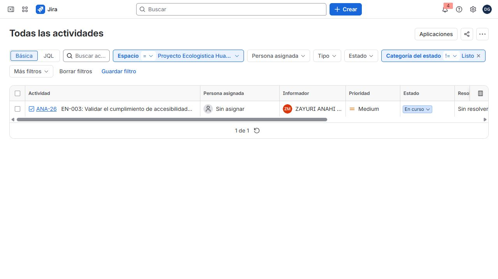

[← Volver al README principal](../../../README.md)

# Estado final del cierre de Jira

> **Evidencia adicional del 28/11/2026.** [Resultados actuales de sesión, navegación, interfaz nativa de accesibilidad y disponibilidad](Cierre%20de%20validaciones%2028nov.md). 236 pruebas unitarias web, 54 casos de accesibilidad/sesión, 16 árboles nativos y tres verificaciones móviles adicionales aprobados. Jira ANA-26 sigue En curso; no se acredita conformidad integral WCAG ni SLA mensual. [CI y despliegue verificados](../evidencias/validacion-cierre-28nov.json).

**Corte final:** 27/11/2026. Fuente: interfaz autenticada de ANA. Se conservaron los cortes anteriores.

## Cambios realizados y verificados

- Se completó el ahorro monetario absoluto en API, panel Sostenibilidad y PDF, con distinción entre ahorro, incremento y datos faltantes.
- Se aclaró ANA-107 como notificación con enlace de descarga, con criterio y evidencia, tras autorización específica.
- Se pasaron a Listo las 40 subtareas inicialmente abiertas y las historias ANA-13, ANA-14 y ANA-15.
- Quedaron **10/10 historias, 99/99 subtareas y 7/7 épicas en Listo**.
- Se publicó exclusivamente el orden de columnas autorizado: Por hacer → En curso → In Review → Listo.
- Se cerraron los Sprints 1–4 sin trasladar trabajo al backlog: **10 + 13 + 29 + 15 = 67 SP**.
- Se registró evidencia y se cerraron ANA-25 (seguridad), ANA-37 (vista del conductor) y ANA-40 (documentación), con autorización específica.
- No se crearon cuentas Confluence ni retrospectivas ficticias al completar los sprints. El Sprint 5 observado queda como borrador vacío, sin iniciarse ni atribuirle trabajo.

## Resultado técnico publicado

Commit funcional `6ef087e`: regresión local de **103 pruebas backend, 229 frontend y cobertura backend 86.34%**. PostGIS, E2E, Android, auditoría Green IT y despliegue aprobaron en CI. [Resultados de GitHub](../evidencias/validacion-tecnica-cierre-27nov.json).

[Aplicación pública](https://ecologistica-web.onrender.com) · [API y Swagger](https://ecologistica-api.onrender.com/docs).

## Validaciones de calidad actualizadas

**122/123 actividades Listo**, una En curso (ANA-26), ninguna Por hacer. Se conservan el corte anterior de 119 Listo y sus capturas como antecedentes.

| Jira | Estado observado | Resultado y límite |
|---|---|---|
| ANA-21 | Listo | Motor sobre PostGIS: 150 pedidos/15 vehículos, 2,099 s; reoptimización 0,049 s. Adaptador vial controlado; no acredita esos tiempos con OSRM público. |
| ANA-29 | Listo | 1.000 pedidos/50 vehículos; 1.000 entregas persistidas sin duplicados; 33 rutas. Carga sintética ejecutada contra PostGIS real. |
| ANA-39 | Listo | Implementación de monitoreo horario, salud que consulta la base y recuperación de exportación tras reinicio local (2,387 s). No acredita SLA mensual ni failover de producción. |
| ANA-26 | En curso | 30/30 auditorías automáticas aprobadas en tres navegadores, correcciones de contraste, etiquetas, teclado y ancho 320 px. Falta acreditar la revisión manual integral WCAG 2.1 AA. |

[Corte observado de calidad](../evidencias/jira-calidad-final-27nov.json) · [Pruebas, capturas y límites](Validaciones%20de%20calidad%20y%20continuidad%2027nov.md).

Los cambios funcionales de calidad se publicaron en main en `924168b`. La revisión automática de accesibilidad y los datos sintéticos no se presentan como certificación universal o evaluación con personas. El objetivo mensual requiere observación real del periodo, aun cuando la tarea de implementar el monitor esté terminada.

[CI y despliegue de calidad verificados](../evidencias/validacion-tecnica-calidad-27nov.json) · [Comprobación pública posterior](../evidencias/muestra-publica-postdeploy-27nov.json).

## Entrega documental y aceptación

Los siete reportes, fuentes de cálculo, capturas, guía de sustentación y registro de transición están preparados. Video excluido por instrucción. Horas, costos, EVM, mood y cinco casos SUS conservan su condición **simulada**. Si el docente exige cinco personas reales, los casos simulados no sustituyen esa evidencia. Tampoco se atribuyen reuniones o firmas inexistentes.

El cierre de sprints sí está realizado; **no se declara cumplimiento global del 100% ni aceptación humana sin evidencia**.

[Datos finales](../evidencias/jira-cierre-final-27nov.json) · [Eventos de cierre por sprint](../evidencias/jira-sprints-cerrados-27nov.json) · [Trazabilidad técnica de las 40 subtareas](Verificacion%20tecnica%20de%20las%2040%20subtareas.md) · [Corte inicial conservado](Conciliacion%20real%20de%20Jira%2027nov.md).

[← Volver al README principal](../../../README.md)
