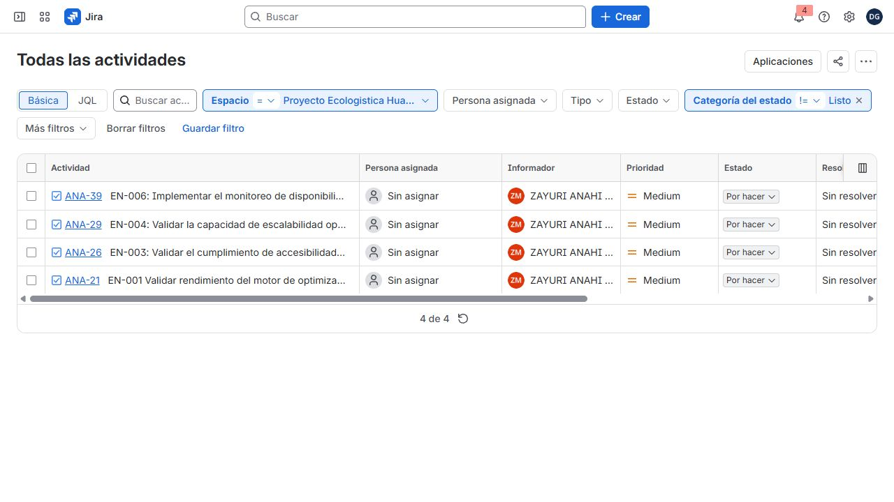

[← Volver al README principal](../../../README.md)

# Estado final del cierre de Jira

**Corte final:** 27/11/2026. Fuente: interfaz autenticada de ANA. Se conservaron los cortes anteriores.

## Cambios realizados y verificados

- Se completó el ahorro monetario absoluto en API, panel Sostenibilidad y PDF, con distinción entre ahorro, incremento y datos faltantes.
- Se aclaró ANA-107 como notificación con enlace de descarga, con criterio y evidencia, tras autorización específica.
- Se pasaron a Listo las 40 subtareas inicialmente abiertas y las historias ANA-13, ANA-14 y ANA-15.
- Quedaron **10/10 historias, 99/99 subtareas y 7/7 épicas en Listo**.
- Se publicó exclusivamente el orden de columnas autorizado: Por hacer → En curso → In Review → Listo.
- Se cerraron los Sprints 1–4 sin trasladar trabajo al backlog: **10 + 13 + 29 + 15 = 67 SP**.
- Se registró evidencia y se cerraron ANA-25 (seguridad), ANA-37 (vista del conductor) y ANA-40 (documentación), con autorización específica.
- No se crearon cuentas Confluence ni retrospectivas ficticias al completar los sprints. El Sprint 5 observado queda como borrador vacío, sin iniciarse ni atribuirle trabajo.

## Resultado técnico publicado

Commit funcional `6ef087e`: regresión local de **103 pruebas backend, 229 frontend y cobertura backend 86.34%**. PostGIS, E2E, Android, auditoría Green IT y despliegue aprobaron en CI. [Resultados de GitHub](../evidencias/validacion-tecnica-cierre-27nov.json).

[Aplicación pública](https://ecologistica-web.onrender.com) · [API y Swagger](https://ecologistica-api.onrender.com/docs).

## Cuatro actividades generales todavía abiertas

**119/123 actividades Listo**, cuatro Por hacer, ninguna En curso. Los sprints funcionales cerrados no acreditan por sí solos todos los requisitos de calidad.

| Jira | Requisito | Evidencia que falta para declarar cumplimiento |
|---|---|---|
| [ANA-21](https://continental-team-yg5bc6tv.atlassian.net/browse/ANA-21) | Rendimiento RNF-001 | Acreditar una solución válida con 150 pedidos/15 vehículos en ≤45 s y reoptimización ≤30 s, incluyendo las condiciones del proveedor vial. Las regresiones funcionales no equivalen a esta prueba máxima. |
| [ANA-26](https://continental-team-yg5bc6tv.atlassian.net/browse/ANA-26) | Accesibilidad RNF-003 | Completar auditoría de criterios WCAG 2.1 AA aplicables en las pantallas principales, incluyendo teclado, foco, contraste y comprensión. Las pruebas de controles actuales no certifican el estándar completo. |
| [ANA-29](https://continental-team-yg5bc6tv.atlassian.net/browse/ANA-29) | Capacidad RNF-004 | Ejecutar y conservar una prueba reproducible de 1.000 pedidos diarios y 50 vehículos con registro, consulta y funciones esenciales, comprobando integridad y límites del entorno. |
| [ANA-39](https://continental-team-yg5bc6tv.atlassian.net/browse/ANA-39) | Disponibilidad RNF-006 | Acreditar ≥99.5% mensual entre 05:00 y 22:00 y recuperación íntegra. El monitoreo real de dos horas (239/240 muestras) no cubre un mes; no se puede completar ese periodo retroactivamente. |

No se marcaron estas validaciones como aprobadas por tener código o pruebas de otro alcance. El hosting gratuito y OSRM público no acreditan por sí solos carga máxima, capacidad ni disponibilidad mensual. No se contrataron recursos pagos para alterar esta limitación.

## Entrega documental y aceptación

Los siete reportes, fuentes de cálculo, capturas, guía de sustentación y registro de transición están preparados. Video excluido por instrucción. Horas, costos, EVM, mood y cinco casos SUS conservan su condición **simulada**. Si el docente exige cinco personas reales, los casos simulados no sustituyen esa evidencia. Tampoco se atribuyen reuniones o firmas inexistentes.

El cierre de sprints sí está realizado; **no se declara cumplimiento global del 100% ni aceptación humana sin evidencia**.

[Datos finales](../evidencias/jira-cierre-final-27nov.json) · [Eventos de cierre por sprint](../evidencias/jira-sprints-cerrados-27nov.json) · [Trazabilidad técnica de las 40 subtareas](Verificacion%20tecnica%20de%20las%2040%20subtareas.md) · [Corte inicial conservado](Conciliacion%20real%20de%20Jira%2027nov.md).

[← Volver al README principal](../../../README.md)
