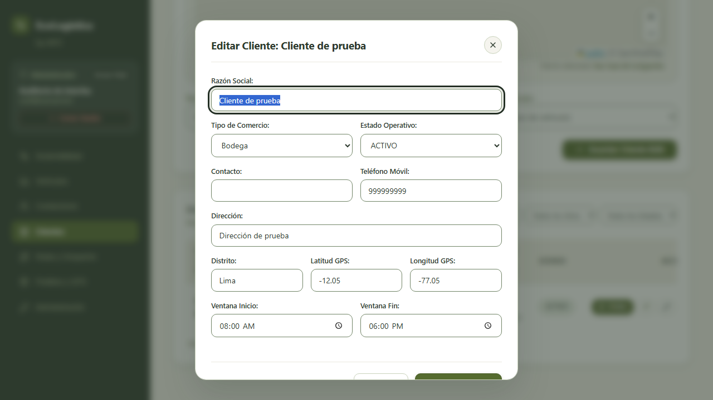
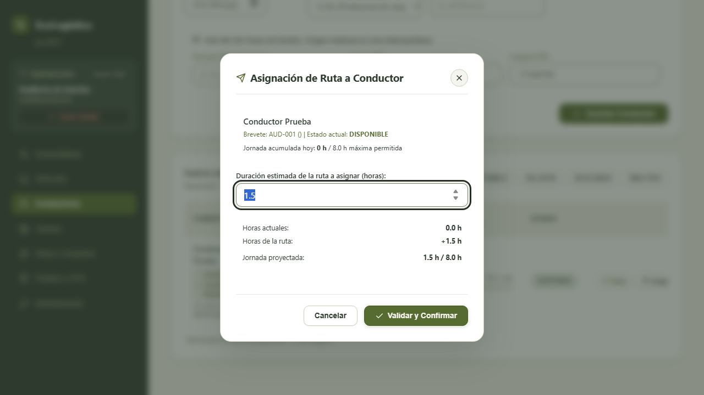
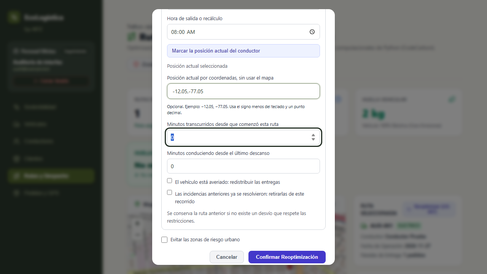
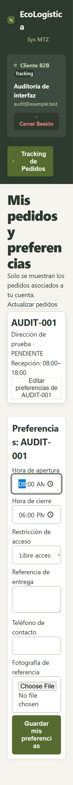
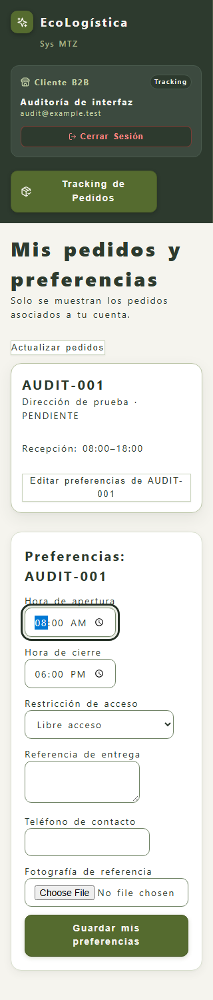

[← Volver al README principal](../../../README.md)

# Revisión adicional de accesibilidad y monitoreo

**Fecha:** 27/11/2026, hora de Lima. Evaluación técnica realizada por el agente mediante inspección de código, revisión visual de capturas y pruebas de navegador. Las entradas de prueba y respuestas de API son sintéticas; los resultados de ejecución son reales. No son encuestas de personas ni una declaración universal de conformidad WCAG.

## Hallazgos corregidos

| Hallazgo de la revisión | Cambio y verificación |
|---|---|
| El título del documento no identificaba el módulo al navegar. | Título por ruta y rol; el foco pasa al contenido principal. Verificado en los quince escenarios. |
| Algunos campos anulaban el contorno de foco mediante estilos en línea. | Contorno de teclado consistente, con comprobación del estilo calculado en navegador. |
| Los diálogos permitían que el contenido de fondo siguiera disponible para interacción. | Fondo `inert` mientras está abierto el diálogo; Tab y Shift+Tab permanecen dentro, Escape cierra y el foco vuelve al control de origen. Verificado en seis diálogos y tres navegadores. |
| Los avisos no tenían semántica de estado o error y varios errores desaparecían a los seis segundos. | `status` para confirmaciones, `alert` para errores; errores persistentes y controles de cierre con nombre. Los errores de un formulario se presentan dentro de su diálogo, sin duplicarlos detrás. Las regresiones verifican que un rechazo del servidor conserve los datos y el formulario. |
| El cierre de la edición del vehículo no tenía nombre accesible. | Etiqueta explícita de cierre y auditoría del diálogo. |
| Una atribución del mapa se distinguía solo por color. | Enlace subrayado, conservando la atribución original. |
| La posición del conductor y el área de incidencia exigían marcar el mapa con ratón. | Alternativa por coordenadas en Reoptimizar → «Introducir el área con coordenadas, sin usar el mapa». Se comprueban rangos y área no degenerada. La API recibe el mismo polígono y posición que en la selección por mapa. Dos pruebas unitarias nuevas verifican el payload y el rechazo de una posición fuera de rango. |
| Los campos de ingreso no indicaban su propósito al gestor de contraseñas. | Autocompletado de usuario y contraseña actual, sin impedir pegar credenciales. |

## Resultado reproducible

**231 pruebas unitarias web aprobadas**. TypeScript, Vite y precompresión aprobados. La auditoría ampliada pasó **45/45 pruebas**, sin omisiones ni reintentos: quince escenarios en Chromium, Firefox y WebKit. Incluye los diez recorridos anteriores y edición de vehículo, edición de conductor, validación de jornada, edición de cliente y reoptimización.

[Resultados por escenario y navegador](../evidencias/auditoria-ampliada-accesibilidad-27nov.json) · [Prueba de navegador](../../../src/frontend/e2e/accessibility.spec.ts) · [Pruebas del envío de coordenadas](../../../src/frontend/src/pages/RutasView.test.tsx) · [Control del diálogo](../../../src/frontend/src/components/AccessibleDialog.tsx).

Las seis capturas de diálogos se revisaron visualmente: encabezados y etiquetas distinguibles, foco visible y contenido de fondo atenuado. En los formularios largos el panel tiene desplazamiento; las pruebas alcanzan los botones finales mediante teclado. Las capturas de 320 px muestran los controles sin salir del ancho de la ventana en el alcance comprobado.

## Reglas que requieren interpretación manual

El JSON conserva todas las entradas `incomplete` de axe; no se contaron como aprobaciones automáticas. Dos corresponden a símbolos decorativos ocultos a tecnologías de asistencia: el signo menos del zoom y la flecha del intervalo de fechas. Los botones de zoom y los campos de fecha tienen su propio nombre. Otras entradas indican fondo solapado u ocultación parcial de texto, especialmente tarjetas del mapa y un textarea. Las capturas permiten inspeccionar el estado, pero esa inspección no se transforma en una medición de contraste de todas las superposiciones posibles.

### Texto ampliado y espaciado: comprobación adicional

Se ejecutaron doce comprobaciones adicionales en Chromium: seis escenarios con tamaño de texto duplicado y los mismos seis con altura de línea 1,5, separación entre letras 0,12 em, entre palabras 0,16 em y entre párrafos 2 em. Ancho de prueba: 320 CSS px. Se comprobó que los campos y el ancho completo del documento permanecieran dentro de la ventana, con un margen de un píxel. **12/12 aprobadas**. La revisión detectó y corrigió desbordamiento de títulos, perfil, grupos de acciones y tarjeta de ingreso; el nombre y correo del perfil ahora pueden ocupar varias líneas.

El cambio de tamaño se aplicó al estilo calculado del texto, no al zoom nativo del navegador. Los diálogos se verifican en los 45 casos anteriores; la comprobación adicional de ancho se realiza después de cerrarlos. No se extrapola a todos los estados posibles.

[Resultados de texto](../evidencias/verificacion-texto-27nov.json) · [Script reproducible](../../../scripts/check_accessible_text.py). Con el frontend local activo, ejecutar `python scripts/check_accessible_text.py --mode resize --output outputs/text-resize.json` y repetir con `--mode spacing`. El script usa los fixtures aislados existentes y elimina únicamente su archivo temporal al finalizar.

**ANA-26 conserva alcance pendiente:** estas verificaciones resuelven los defectos encontrados, pero aún falta acreditar lectura y anuncio con tecnología de asistencia y las condiciones de sesión y navegación de todos los procesos completos. No se declara conformidad integral a partir de los casos seleccionados.

### Incidencia de CI conservada

La [ejecución de CI del commit 10079d1](https://github.com/MartinezJhef/EcoLogistica-Lima/actions/runs/46105363146) aprobó 56 de 57 casos, pero falló la comprobación de foco del cliente en WebKit. El despliegue quedó bloqueado. Se amplió el estilo de foco a los controles con foco interno nativo y se usó una aserción que espera la actualización del estilo; la comprobación dirigida de WebKit y las 231 pruebas unitarias pasaron localmente. La publicación requiere que la nueva ejecución completa de CI apruebe; este fallo no se elimina del historial ni se presenta como un despliegue exitoso.

La [ejecución siguiente, commit 77337e2](https://github.com/MartinezJhef/EcoLogistica-Lima/actions/runs/46106163929), aprobó el foco anterior, pero encontró cuatro campos de origen/destino de pedidos fuera de 320 px en WebKit/Linux: de nuevo 56/57 casos. Se corrigió la regla móvil para que los contenedores flex verticales conserven `nowrap`; la regla de adaptación de grupos horizontales había afectado esas columnas. La construcción y precompresión aprobaron tras la corrección. Se conserva esta incidencia por separado de los resultados locales previos.

Referencias de revisión: [lista de criterios WCAG 2.1 del W3C](https://www.w3.org/WAI/WCAG21/quickref/) y [patrón de diálogo modal del W3C](https://www.w3.org/WAI/ARIA/apg/patterns/dialog-modal/).

## Continuación real del monitoreo

Entre **19:29 y 19:31 de Lima**, se observaron seis muestras HTTP (tres web y tres API), todas HTTP 200. Duración: 120,42 s; intervalo de 60 s. Web: 67,83–268,49 ms; API: 354,33–360,05 ms. Son respuestas de esos endpoints en esa ventana; no acreditan el tiempo de login, el de todas las APIs o un SLA mensual.

[Muestras con fechas UTC originales](../evidencias/monitoreo-continuacion-real-27nov.json). Se conserva por separado el [timeout de la primera ejecución operativa](../evidencias/monitoreo-operativo-inicial-27nov.json); no se elimina del historial ni se combina con esta ventana para ocultarlo.

El workflow `Operational availability samples` fue consultado y figura **activo**. Al revisar sus artefactos solo constaba la primera ejecución manual; todavía no se había observado una ejecución disparada por el cron. [Corte observado del seguimiento](../evidencias/seguimiento-monitoreo-real-27nov.json) · [workflow operativo](../../../.github/workflows/availability.yml). El horario está configurado, pero no se afirma una continuidad programada o mensual aún no observada.

[← Volver al README principal](../../../README.md)
