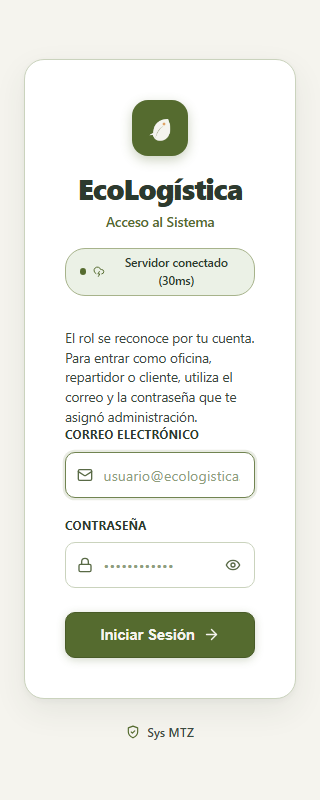
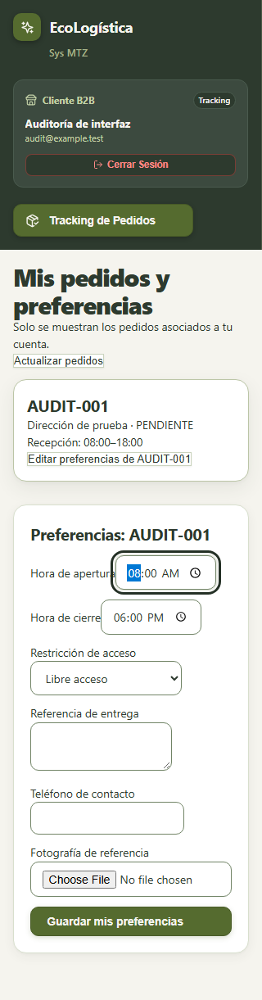
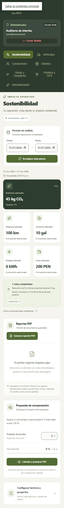

[← Volver al README principal](../../../README.md)

# Validaciones de calidad y continuidad — 27/11/2026

Este anexo registra mediciones ejecutadas y correcciones del sistema. Los pedidos, vehículos, respuestas de API y exportaciones usados como entradas de prueba son sintéticos; los tiempos y resultados se midieron al ejecutar el código. No equivalen a encuestas de personas ni a una certificación integral de producción.

## Rendimiento y capacidad

Se ejecutó el servicio real sobre PostgreSQL/PostGIS desechable, con un adaptador vial controlado para aislar el motor del proveedor externo. La prueba inicial de 150 pedidos agotaba el tiempo disponible tras 35,62 s. Se añadió una construcción rápida de solución completa que conserva las validaciones de capacidad, ventanas, conductor y acceso. Solo se acepta directamente si asigna todos los pedidos; de lo contrario se conserva la búsqueda original. No se declara optimalidad global del costo.

| Ejecución medida | Resultado |
|---|---|
| 150 pedidos / 15 vehículos | 150 asignados; cinco rutas; optimización 2,099 s; reoptimización 0,049 s |
| 1.000 pedidos / 50 vehículos | 1.000 entregas distintas persistidas; 33 rutas; sin reutilizar conductor |
| Registro de 1.000 pedidos | 0,271 s |
| Consulta de todas las páginas | 0,057 s; sin omisiones ni duplicados |
| Siete lotes de planificación de los 1.000 pedidos | Entre 1,191 y 5,110 s por lote |
| Caso de asignación parcial | Conserva la búsqueda original; no publica una heurística parcial como máximo verificado |

También se corrigió la ordenación de la paginación: los registros con la misma fecha ahora se ordenan por su identificador único. Las tres pruebas de capacidad pasaron sobre PostGIS real. [Mediciones originales](../evidencias/medicion-capacidad-postgis-27nov.json).

Código reproducible: [pruebas de capacidad](../../../src/backend/tests/test_quality_capacity.py), [planificación](../../../src/backend/app/services/planning_service.py) y [consulta de pedidos](../../../src/backend/app/services/order_service.py). CI conserva sus mediciones como artefacto `postgis-capacity-measurements`.

**Límite:** estos resultados acreditan el motor y la persistencia bajo la carga descrita. Excluyen latencia y límites del OSRM público, concurrencia entre clientes y capacidad del alojamiento gratuito. El proveedor vial público mantiene su limitación de solicitudes y puede impedir alcanzar esos tiempos en producción. La medición interna tampoco demuestra que todos los endpoints públicos respondan en menos de 500 ms.

## Accesibilidad de las pantallas principales

Se auditaron diez escenarios renderizados: ingreso, vehículos, conductores, clientes, pedidos de oficina, rutas, administración de usuarios, sostenibilidad, preferencias del cliente y consulta del repartidor. Se utilizaron Chromium, Firefox y WebKit: **30 pruebas**, sin violaciones detectadas por axe en las reglas WCAG 2.1 A/AA aplicadas.

Se corrigieron asociaciones entre etiquetas y campos, nombres de selectores, contraste de textos, foco visible, enlace para saltar la navegación y distribución de formularios en 320 px. Los diálogos controlan Tab, Escape y restitución del foco. La prueba de usuarios comprueba el recorrido del diálogo con teclado. Se respeta la preferencia de movimiento reducido.

La ejecución usa respuestas de API controladas para auditar estados reproducibles. [Resultados por pantalla y navegador, con reglas de revisión manual](../evidencias/auditoria-accesibilidad-27nov.json). [Prueba reproducible](../../../src/frontend/e2e/accessibility.spec.ts).

**Límite:** cero violaciones automáticas en los estados revisados no certifica todos los criterios WCAG. Las reglas incompletas del JSON requieren revisión manual; no se acredita una evaluación con lector de pantalla ni una prueba de usabilidad con personas. El SUS de cinco participantes sigue identificado como simulado.

## Continuidad y recuperación

El endpoint de salud ahora ejecuta `SELECT 1` contra la base y devuelve 503 si falla, sin exponer la excepción ni las credenciales. Las dos pruebas de salud verifican las respuestas sana y fallida. [Implementación](../../../src/backend/app/api/v1/endpoints/health.py) y [pruebas](../../../src/backend/tests/test_health_readiness.py).

Se probó un reinicio planificado de PostgreSQL en una instancia local aislada: una exportación pendiente sobrevivió sin cambios, el trabajador retomó el proceso y produjo un PDF válido. Reinicio y reanudación: **2,387 s**. Se eliminó únicamente el registro de esa prueba. [Resultado medido](../evidencias/recuperacion-postgis-local-27nov.json) y [script reproducible con restricciones de seguridad](../../../scripts/check_test_database_recovery.py). No se provocó una caída en la base publicada.

Se añadió [muestreo operativo programado](../../../.github/workflows/availability.yml): una consulta a la web y al estado de la API cada hora entre 05:00 y 21:00 de Lima, con artefactos retenidos 90 días y sin solicitudes de precalentamiento. GitHub puede retrasar ejecuciones programadas. Las muestras se conservan con fecha UTC y sus fallos; no se convierten en disponibilidad continua.

La [primera ejecución operativa](../evidencias/monitoreo-operativo-inicial-27nov.json), a las 18:43 de Lima, registró web HTTP 200 en 234,26 ms y API sin respuesta dentro de 20 s (`ReadTimeout`): una de dos muestras disponibles. Se conserva el fallo. Que el workflow termine correctamente significa que recogió la evidencia; no que ambos servicios estuvieran disponibles. La muestra precede a la finalización del despliegue de calidad y no se usa como medición de latencia del nuevo commit.

Después del despliegue aprobado, una [nueva comprobación pública](../evidencias/muestra-publica-postdeploy-27nov.json) obtuvo HTTP 200 en web y API. Es una muestra posterior independiente; no borra el timeout previo ni establece un SLA.

**Pendiente temporal:** el objetivo de ≥99,5 % mensual en horario 05:00–22:00 exige observación real durante el periodo. Las 239/240 muestras históricas de dos horas y el reinicio local no prueban ese SLA ni el failover de Neon/Render. La instrumentación y la recuperación están implementadas; la aceptación mensual permanece pendiente de evidencia.

## Regresión

Se mantuvieron aprobadas 229 pruebas unitarias web. El conjunto backend local pasó 105 pruebas, con cuatro integraciones omitidas en SQLite; las tres nuevas pruebas de capacidad se ejecutaron aparte sobre PostGIS. La compilación TypeScript/Vite y la precompresión finalizaron correctamente. La publicación debe acompañarse del resultado de CI y despliegue del commit correspondiente; estos resultados locales no sustituyen esa verificación.

GitHub aprobó CI, pruebas Sprint 4, validación funcional hasta Sprint 3 (incluye PostGIS, Android y entorno desechable), Green IT y el despliegue de producción del commit `924168b`. [Registro de ejecuciones y enlace al despliegue](../evidencias/validacion-tecnica-calidad-27nov.json). Se conserva también el segundo despliegue del mismo SHA que dispara el otro workflow, con el estado observado al recoger la evidencia.
